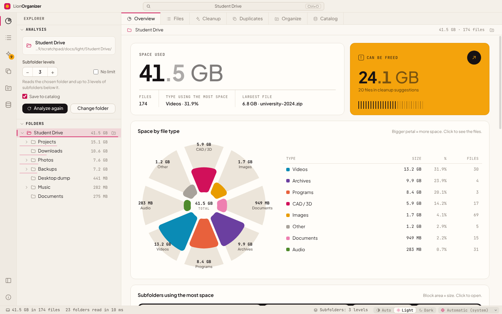

<div align="center">


# LionOrganizer

**Disk space analysis & cleanup for Windows, macOS and Linux.**<br>
See what takes up space in your folders, find true duplicates by content and safely free up what you no longer need.

<sub>by the <b>LionOrganizer Team</b> · created and conceived by <b>Daniel Michelon De Carli</b></sub>

**English** · [Português (Brasil)](docs/README.pt-BR.md) · [Português (Portugal)](docs/README.pt-PT.md) · [Español](docs/README.es.md) · [Français](docs/README.fr.md) · [Deutsch](docs/README.de.md) · [Italiano](docs/README.it.md) · [简体中文](docs/README.zh-CN.md) · [日本語](docs/README.ja.md) · [한국어](docs/README.ko.md)


<p>
  <a href="https://github.com/danielcarli/lionorganizer/releases/latest/download/LionOrganizer-Setup.exe"></a>
  <a href="https://github.com/danielcarli/lionorganizer/releases/latest/download/LionOrganizer-mac-universal.dmg"></a>
  <a href="https://github.com/danielcarli/lionorganizer/releases/latest/download/lionorganizer_amd64.deb"></a>
  <a href="https://github.com/danielcarli/lionorganizer/releases/latest/download/lionorganizer.x86_64.rpm"></a>
  <a href="https://github.com/danielcarli/lionorganizer/releases/latest/download/LionOrganizer-x86_64.AppImage"></a>
</p>

<sub><a href="https://github.com/danielcarli/lionorganizer/releases">All versions</a> · <a href="#download">How to install</a></sub>



</div>

## Why LionOrganizer?

Disk analyzers tell you *what* is big. LionOrganizer also helps you decide *what can go* — and makes sure nothing is deleted by accident. It was born from a very concrete problem: architecture and design projects pile up CAD backups (`.skb`, `.0001.rvt`, `.bak`), renders, videos and copies of copies until the disk is full.

Everything runs **locally**. There is no account and no telemetry; the only connection is an optional check for new versions.

**What sets LionOrganizer apart**

- **It helps you decide, not just measure** — cleanup suggestions grouped by reason, including the CAD/BIM backups that pile up in architecture projects (SketchUp `.skb`, Revit `.0001.rvt`, AutoCAD `.bak`).
- **Nothing is deleted by accident** — every deletion asks for a code you type, checked by the app itself, and files go to the Recycle Bin.
- **True duplicates, by content** — confirmed with SHA-256, and you choose which copy to keep.
- **Memory across analyses** — a local catalog to search every folder you have analyzed (even disconnected drives) and see what is new, removed or growing.
- **Organize and rename, with undo** — loose files sorted into folders by type and batch renaming with patterns, always with a preview.
- **A second opinion from AI** — export a report in your language for an AI to point out what is probably the safest to delete; the app sends it nowhere. Then paste its answer back: the files it cites are listed with the risk it gave, ready to review.
- **Knows when files disappear** — files deleted or moved outside the app are shown in gray, and you can remove them from the lists.
- **For everyone** — 10 languages, light and dark themes, and verified installers for Windows, macOS and Linux.

## Download

Download the installer for your system. Every installer gets the **latest version** from GitHub, and every file is checked (SHA-256 and signed build provenance).

- **Windows 10/11** (x64, ARM): a setup wizard of about 2 MB that downloads and checks the app during installation. → [`LionOrganizer-Setup.exe`](https://github.com/danielcarli/lionorganizer/releases/latest/download/LionOrganizer-Setup.exe)
- **macOS 11+** (Apple Silicon, Intel): open the `.dmg` and drag LionOrganizer to Applications. → [`LionOrganizer-mac-universal.dmg`](https://github.com/danielcarli/lionorganizer/releases/latest/download/LionOrganizer-mac-universal.dmg)
- **Linux** (x64): `.deb` for Ubuntu, Debian, Mint…, `.rpm` for Fedora, RHEL, openSUSE…, or the AppImage for any distribution, with no installation. → [`.deb`](https://github.com/danielcarli/lionorganizer/releases/latest/download/lionorganizer_amd64.deb) · [`.rpm`](https://github.com/danielcarli/lionorganizer/releases/latest/download/lionorganizer.x86_64.rpm) · [AppImage](https://github.com/danielcarli/lionorganizer/releases/latest/download/LionOrganizer-x86_64.AppImage)

> The installers are not signed with a paid certificate yet. On first launch, Windows may show "Windows protected your PC" (**More info › Run anyway**) and macOS asks you to allow the app in **System Settings › Privacy & Security › Open Anyway**.

**Prefer the terminal?** Windows (PowerShell, no administrator needed):

```powershell
irm https://github.com/danielcarli/lionorganizer/releases/latest/download/install.ps1 | iex
```

macOS and Linux:

```bash
curl -fsSL https://github.com/danielcarli/lionorganizer/releases/latest/download/install.sh | bash
```

[All versions](https://github.com/danielcarli/lionorganizer/releases) · [Installation guide](docs/INSTALL.md): details, how it stays safe, updating and uninstalling.

## Features

| | |
|---|---|
| **Analyze** | Scans a folder and its subfolders — 3 levels deep by default, configurable up to 50 levels or unlimited. Folder tree with sizes, breadcrumbs and a sortable, filterable table of every file. |
| **Big folders** | The last analysis reopens instantly from the catalog, marked with its date; the folder is analyzed again only when you ask, in the background. Shows the space analyzed next to the space used on the disk, and why they differ (inaccessible items, depth limit, system files). Optional list of folders to ignore (`node_modules`, `.git`, system folders) — off by default. Items the system did not let the app read are listed with the reason; on Windows you can analyze again as administrator. |
| **Visualize** | Space by file type (rose chart), biggest subfolders (treemap), a 100-dot matrix where each dot is 1 % of the space, largest extensions and file age. |
| **Space map** | Full-screen treemap: every file is a block, nested in its folders and colored by type. Click a block to zoom into its folder; Backspace or right-click goes up. Heavy for big analyses, so it is only built when you turn it on — in the background, with a progress bar. |
| **Clean up** | Suggestions grouped by reason: SketchUp/Revit/AutoCAD backups, temporary files, logs, unfinished downloads, installers, large old files. |
| **More to clean** | Render and CAD caches (Twinmotion, Lumion, Enscape, V-Ray, Corona, Revit journals, Adobe Media Cache), empty files and empty folders — folders also go to the Recycle Bin only after the typed code. |
| **True duplicates** | Content comparison with SHA-256, read only when needed (size → first/last 64 KB → whole file). Choose which copy to keep; see when the same file also exists in another catalogued folder (e.g. a backup drive). |
| **Organize** | Move loose files into subfolders by type, and rename in batches with patterns like `{date}-{n}-{name}`. Always with a preview, and undoable. |
| **Catalog & history** | A local SQLite catalog of names, sizes, dates and hashes. Search across every folder you have analyzed — even disconnected drives — and compare scans to see what is new, removed or growing. |
| **10 languages** | English, Português (Brasil), Português (Portugal), Español, Français, Deutsch, Italiano, 简体中文, 日本語, 한국어 — detected from the system, switchable in the status bar. |
| **Light & dark** | Automatic or manual theme, with a color palette checked for color-vision deficiencies. |

## Safety first

Deleting the wrong file is worse than a full disk, so LionOrganizer is deliberately careful:

- **Typed confirmation code.** Every action that changes files — *any* deletion (one file or many), organizing, renaming, undoing and clearing the catalog — shows a 6-character code that must be **typed** (pasting is disabled) before the button unlocks. The code is generated and checked by the main process, so the interface cannot skip it. Five wrong attempts cancel the operation.
- **Recycle Bin, not permanent delete.** Deleted files go to the Windows Recycle Bin.
- **Scoped actions.** The main process only touches files that belong to the folder you analyzed and were seen in the last scan.
- **Undo.** Organize and rename operations are logged and can be reverted from *Catalog → Recent operations*.
- **Read-only by default.** Analyzing and checking for duplicates never modify anything.

<div align="center">

</div>

## Screenshots

| | |
|---|---|
|  **Duplicates** — identical copies grouped by SHA-256 |  **Cleanup** — suggestions grouped by reason |
|  **Organize** — by type and batch rename, with preview |  **Catalog** — search, history and undo |
|  **Files** — every file, sortable and filterable |  **Dark theme** |

<div align="center">

<br><sub>The same screen in the ten supported languages.</sub>
</div>

## Getting started

### Run from source (Windows)

1. Install [Node.js LTS](https://nodejs.org).
2. Download or clone this repository.
3. Double-click **`start.bat`** — the first run installs the dependencies.

Or from a terminal:

```powershell
npm install
npm start
```

> On PowerShell, if scripts are disabled, use `npm.cmd` instead of `npm`.

### Build an installer

Double-click **`build-installer.bat`** (or run `npm run dist`). An installer and a portable `.exe` are created in `dist/`.

## Keyboard shortcuts

| Shortcut | Action |
|---|---|
| `Ctrl+O` | Open a folder |
| `F5` | Analyze again |
| `Ctrl+1` … `Ctrl+7` | Overview · Files · Cleanup · Duplicates · Organize · Catalog · Space map |
| `Ctrl+B` | Show/hide the side bar |
| `Esc` | Cancel the running analysis or duplicate check |

## Languages

| Language | Code | | Language | Code |
|---|---|---|---|---|
| English | `en` | | Deutsch | `de` |
| Português (Brasil) | `pt-BR` | | Italiano | `it` |
| Português (Portugal) | `pt-PT` | | 简体中文 | `zh-CN` |
| Español | `es` | | 日本語 | `ja` |
| Français | `fr` | | 한국어 | `ko` |

The language follows Windows by default and can be changed in the status bar. Numbers, dates and size units follow the selected language (for example, French shows *Mo* and *Go*). Missing translations fall back to English.

Want to add or improve a language? See [CONTRIBUTING.md](CONTRIBUTING.md#translations) — it only takes a JSON file.

## Privacy

LionOrganizer works offline. Its only connection is the check for new versions: it reads one small file from the project's releases on GitHub and sends no data about you or your files. You can turn it off by clicking the version number in the bottom-right corner. The *Export for AI* report is never sent anywhere by the app: you choose where to paste it.

The catalog is a single file on your computer:

```
%APPDATA%\LionOrganizer\catalog.sqlite
```

You can turn recording off ("Save to catalog" in the side bar), export it to CSV or clear it from the *Catalog* view at any time. Clearing the catalog never deletes your files.

## Architecture

The code follows the layering of [Visual Studio Code](https://github.com/microsoft/vscode): `base` knows nothing above it, `platform` provides system services, and `workbench` builds the interface. The main process (Node.js) and the interface (a sandboxed renderer without Node access) only talk through the `preload` bridge.

```
src/
  base/
    common/              pure utilities: events, formatting, i18n (nls.js)
    browser/             DOM helpers, icons, charts (rose, treemap, dot matrix, bars, hatched columns)
  platform/              main-process services
    files/               folder scanner with depth limit
    catalog/             SQLite catalog, history, operation log, duplicate finder (SHA-256)
    operations/          file-changing operations guarded by the typed confirmation code
    shell/ · dialogs/    Explorer integration, native dialogs
    nls/                 i18n for the main process
  code/
    electron-main/       entry point: window, app:// protocol, service wiring
    electron-sandbox/    preload bridge
  nls/                   message catalogs: en.json, pt-BR.json, … (one file per language)
  workbench/
    browser/             bootstrap, layout parts (title bar, activity bar, side bar, editor, status bar), styles
    services/            analysis model, scan, layout, notifications, operations, confirmation, duplicates, catalog
    contrib/             views: overview, files, cleanup, duplicates, organize, catalog
```

Security: `contextIsolation` and `sandbox` on, no `nodeIntegration`, a strict Content Security Policy, and every file-changing request is validated in the main process.

## Development

| Command | What it does |
|---|---|
| `npm start` | Run the app |
| `npm run dist` | Build the Windows installer and portable app |
| `npm run test:e2e` | End-to-end test: analyzes a **disposable** folder and exercises duplicates, deletion, organize, rename, undo and the catalog, checking the results on disk |
| `npm run docs:screenshots` | Regenerate the screenshots in `docs/screenshots` |
| `npm run release:assets` | Build the release assets used by the installers in `dist-release/` (published automatically when a `v*` tag is pushed) |

```powershell
# the end-to-end test changes files: always point it to a throwaway folder
$env:E2E_FOLDER="C:\temp\lion-test"; $env:E2E_OUT="C:\temp\lion-out"; npm run test:e2e
```

## Changelog

See [CHANGELOG.md](CHANGELOG.md) — current version: **1.1.6**.

## Contributing

Bug reports, ideas and pull requests are welcome — especially translations. Please read [CONTRIBUTING.md](CONTRIBUTING.md).

## Credits

LionOrganizer was **created and conceived by Daniel Michelon De Carli**, an architecture and urbanism student, and is maintained by the **LionOrganizer Team** together with its contributors and translators.

Bundled fonts: [Plus Jakarta Sans](https://github.com/tokotype/PlusJakartaSans) and [JetBrains Mono](https://github.com/JetBrains/JetBrainsMono), under the SIL Open Font License. The architecture is inspired by [Visual Studio Code](https://github.com/microsoft/vscode).

## License

Copyright © 2026 LionOrganizer Team.

LionOrganizer is free software: you can redistribute it and/or modify it under the terms of the **[GNU General Public License v3.0](LICENSE)** as published by the Free Software Foundation, either version 3 of the License, or (at your option) any later version. It is distributed in the hope that it will be useful, but **without any warranty**; see the license for details.

In short: you may use, study, share and change LionOrganizer freely; if you distribute a modified version, it must also be released under the GPL with its source code.
