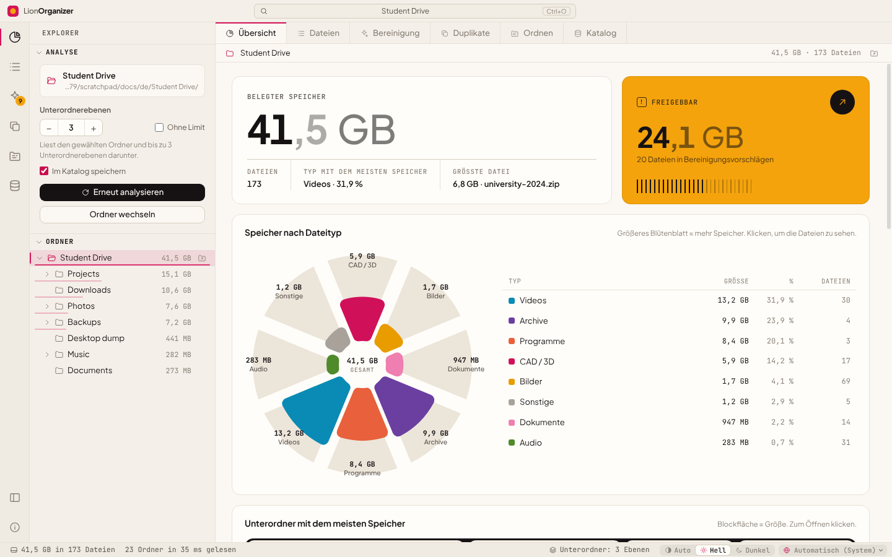

<div align="center">


# LionOrganizer

**Speicherplatz analysieren und aufräumen unter Windows, macOS und Linux.**<br>
Sehen, was in den Ordnern Platz belegt, echte Duplikate anhand ihres Inhalts finden und sicher freigeben, was nicht mehr gebraucht wird.

<sub>vom <b>LionOrganizer Team</b> · erdacht und entwickelt von <b>Daniel Michelon De Carli</b></sub>

[English](../README.md) · [Português (Brasil)](README.pt-BR.md) · [Português (Portugal)](README.pt-PT.md) · [Español](README.es.md) · [Français](README.fr.md) · **Deutsch** · [Italiano](README.it.md) · [简体中文](README.zh-CN.md) · [日本語](README.ja.md) · [한국어](README.ko.md)


<p>
  <a href="https://github.com/danielcarli/lionorganizer/releases/latest/download/LionOrganizer-Setup.exe"></a>
  <a href="https://github.com/danielcarli/lionorganizer/releases/latest/download/LionOrganizer-mac-universal.dmg"></a>
  <a href="https://github.com/danielcarli/lionorganizer/releases/latest/download/lionorganizer_amd64.deb"></a>
  <a href="https://github.com/danielcarli/lionorganizer/releases/latest/download/lionorganizer.x86_64.rpm"></a>
  <a href="https://github.com/danielcarli/lionorganizer/releases/latest/download/LionOrganizer-x86_64.AppImage"></a>
</p>

<sub><a href="https://github.com/danielcarli/lionorganizer/releases">Alle Versionen</a> · <a href="#download">Installation</a></sub>



</div>

## Warum LionOrganizer?

Speicheranalyse-Tools zeigen, *was* groß ist. LionOrganizer hilft außerdem bei der Entscheidung, *was weg kann* – und sorgt dafür, dass nichts versehentlich gelöscht wird. Entstanden ist es aus einem ganz konkreten Problem: In Architektur- und Designprojekten sammeln sich CAD-Sicherungen (`.skb`, `.0001.rvt`, `.bak`), Renderings, Videos und Kopien von Kopien, bis der Datenträger voll ist.

Alles läuft **lokal**. Kein Konto, keine Telemetrie; die einzige Verbindung ist eine optionale Suche nach neuen Versionen.

**Was LionOrganizer besonders macht**

- **Hilft beim Entscheiden, nicht nur beim Messen** — Aufräumvorschläge nach Grund gruppiert, auch für die CAD-/BIM-Sicherungen, die sich in Architekturprojekten ansammeln (SketchUp `.skb`, Revit `.0001.rvt`, AutoCAD `.bak`).
- **Nichts wird versehentlich gelöscht** — jedes Löschen verlangt einen eingetippten Code, den die App selbst prüft, und Dateien kommen in den Papierkorb.
- **Echte Duplikate, nach Inhalt** — per SHA-256 bestätigt, und Sie entscheiden, welche Kopie bleibt.
- **Gedächtnis über Analysen hinweg** — ein lokaler Katalog, um alle analysierten Ordner zu durchsuchen (auch getrennte Laufwerke) und zu sehen, was neu, entfernt oder gewachsen ist.
- **Ordnen und umbenennen, mit Rückgängig** — lose Dateien nach Typ in Ordner sortieren und Stapelumbenennung mit Mustern, immer mit Vorschau.
- **Eine zweite Meinung von der KI** — exportieren Sie einen Bericht in Ihrer Sprache, damit eine KI zeigt, was sich wahrscheinlich am sichersten löschen lässt; die App sendet nichts. Fügen Sie die Antwort dann wieder ein: Die genannten Dateien werden mit dem angegebenen Risiko aufgelistet, bereit zur Prüfung.
- **Merkt, wenn Dateien verschwinden** — außerhalb der App gelöschte oder verschobene Dateien erscheinen grau und lassen sich aus den Listen entfernen.
- **Für alle** — 10 Sprachen, helles und dunkles Design und geprüfte Installationsprogramme für Windows, macOS und Linux.

## Download

Laden Sie das Installationsprogramm für Ihr System herunter. Jedes holt die **neueste Version** von GitHub und prüft jede Datei (SHA-256 und signierte Build-Herkunft).

- **Windows 10/11** (x64, ARM): Setup-Assistent mit etwa 2 MB, der die App während der Installation herunterlädt und prüft. → [`LionOrganizer-Setup.exe`](https://github.com/danielcarli/lionorganizer/releases/latest/download/LionOrganizer-Setup.exe)
- **macOS 11+** (Apple Silicon, Intel): die `.dmg` öffnen und LionOrganizer in „Programme“ ziehen. → [`LionOrganizer-mac-universal.dmg`](https://github.com/danielcarli/lionorganizer/releases/latest/download/LionOrganizer-mac-universal.dmg)
- **Linux** (x64): `.deb` für Ubuntu, Debian, Mint …, `.rpm` für Fedora, RHEL, openSUSE … oder das AppImage, das auf jeder Distribution ohne Installation läuft. → [`.deb`](https://github.com/danielcarli/lionorganizer/releases/latest/download/lionorganizer_amd64.deb) · [`.rpm`](https://github.com/danielcarli/lionorganizer/releases/latest/download/lionorganizer.x86_64.rpm) · [AppImage](https://github.com/danielcarli/lionorganizer/releases/latest/download/LionOrganizer-x86_64.AppImage)

> Die Installationsprogramme sind noch nicht mit einem kostenpflichtigen Zertifikat signiert. Beim ersten Start zeigt Windows eventuell „Der Computer wurde durch Windows geschützt“ (**Weitere Informationen › Trotzdem ausführen**), und macOS fragt nach einer Freigabe unter **Systemeinstellungen › Datenschutz & Sicherheit › Dennoch öffnen**.

**Lieber im Terminal?** Windows (PowerShell, keine Administratorrechte nötig):

```powershell
irm https://github.com/danielcarli/lionorganizer/releases/latest/download/install.ps1 | iex
```

macOS und Linux:

```bash
curl -fsSL https://github.com/danielcarli/lionorganizer/releases/latest/download/install.sh | bash
```

[Alle Versionen](https://github.com/danielcarli/lionorganizer/releases) · [Installationsanleitung](INSTALL.md) (auf Englisch): Details, Sicherheit, Aktualisieren und Deinstallieren.

## Funktionen

| | |
|---|---|
| **Analysieren** | Durchsucht einen Ordner und seine Unterordner – standardmäßig 3 Ebenen tief, einstellbar bis 50 Ebenen oder ohne Limit. Ordnerbaum mit Größen, Breadcrumbs und eine sortier- und filterbare Tabelle aller Dateien. |
| **Große Ordner** | Die letzte Analyse öffnet sich sofort aus dem Katalog, mit ihrem Datum; der Ordner wird nur auf Wunsch erneut analysiert, im Hintergrund. Zeigt den analysierten Speicher neben dem belegten Speicher des Datenträgers und warum sie abweichen (unlesbare Elemente, Ebenenlimit, Systemdateien). Optionale Liste zu ignorierender Ordner (`node_modules`, `.git`, Systemordner) – standardmäßig aus. Elemente, die das System nicht lesen ließ, werden mit Grund aufgelistet; unter Windows kann man als Administrator erneut analysieren. Für Millionen von Dateien gebaut: Die schwere Arbeit läuft im Hintergrund, große Listen werden außerhalb der Oberfläche sortiert – das Fenster friert nie ein. |
| **Visualisieren** | Speicher nach Dateityp (Rosendiagramm), größte Unterordner (Treemap), eine Matrix aus 100 Punkten, in der jeder Punkt 1 % des Speichers darstellt, größte Erweiterungen und Dateialter. |
| **Platzkarte** | Treemap im Vollbild: jede Datei ist ein Block, verschachtelt in ihren Ordnern und nach Typ eingefärbt. Ein Klick auf einen Block wechselt in seinen Ordner; Rücktaste oder Rechtsklick geht nach oben. Bei großen Analysen rechenintensiv, daher wird sie erst auf Wunsch aufgebaut – im Hintergrund, mit Fortschrittsbalken. |
| **Bereinigen** | Vorschläge nach Grund gruppiert: SketchUp-/Revit-/AutoCAD-Sicherungen, temporäre Dateien, Protokolle, unvollständige Downloads, Installationsprogramme, große alte Dateien. |
| **Mehr zum Aufräumen** | Render- und CAD-Caches (Twinmotion, Lumion, Enscape, V-Ray, Corona, Revit-Journale, Adobe Media Cache), leere Dateien und leere Ordner – auch Ordner kommen erst nach dem eingetippten Code in den Papierkorb. |
| **Echte Duplikate** | Inhaltsvergleich per SHA-256, gelesen wird nur, wenn nötig (Größe → erste/letzte 64 KB → ganze Datei). Auswählen, welche Kopie behalten wird; sehen, ob dieselbe Datei auch in einem anderen katalogisierten Ordner liegt (z. B. auf einem Sicherungslaufwerk). |
| **Ordnen** | Lose Dateien nach Typ in Unterordner verschieben und stapelweise mit Mustern wie `{date}-{n}-{name}` umbenennen. Immer mit Vorschau und rückgängig zu machen. |
| **Katalog und Verlauf** | Ein lokaler SQLite-Katalog mit Namen, Größen, Datumsangaben und Hashes. Alle bisher analysierten Ordner durchsuchen – auch getrennte Laufwerke – und Scans vergleichen, um zu sehen, was neu, entfernt oder gewachsen ist. |
| **10 Sprachen** | English, Português (Brasil), Português (Portugal), Español, Français, Deutsch, Italiano, 简体中文, 日本語, 한국어 – vom System erkannt, in der Statusleiste umschaltbar. |
| **Hell und dunkel** | Automatisches oder manuelles Design, mit einer auf Farbfehlsichtigkeit geprüften Farbpalette. |

## Sicherheit zuerst

Die falsche Datei zu löschen ist schlimmer als ein voller Datenträger, deshalb ist LionOrganizer bewusst vorsichtig:

- **Bestätigungscode zum Eintippen.** Jede Aktion, die Dateien verändert – *jedes* Löschen (eine Datei oder viele), Ordnen, Umbenennen, Rückgängigmachen und Löschen des Katalogs –, zeigt einen 6-stelligen Code, der **eingetippt** werden muss (Einfügen ist deaktiviert), bevor die Schaltfläche freigegeben wird. Der Code wird im Hauptprozess erzeugt und geprüft, die Oberfläche kann ihn also nicht umgehen. Fünf Fehlversuche brechen den Vorgang ab.
- **Papierkorb statt endgültigem Löschen.** Gelöschte Dateien landen im Windows-Papierkorb.
- **Begrenzte Aktionen.** Der Hauptprozess verändert nur Dateien, die zum analysierten Ordner gehören und beim letzten Scan erfasst wurden.
- **Rückgängig.** Ordnen- und Umbenennen-Vorgänge werden protokolliert und lassen sich unter *Katalog → Letzte Vorgänge* zurücknehmen.
- **Standardmäßig nur lesend.** Analysieren und die Duplikatprüfung verändern nie etwas.

<div align="center">

</div>

## Screenshots

| | |
|---|---|
|  **Duplikate** – identische Kopien, nach SHA-256 gruppiert |  **Bereinigung** – Vorschläge nach Grund gruppiert |
|  **Ordnen** – nach Typ und Stapelumbenennung, mit Vorschau |  **Katalog** – Suche, Verlauf und Rückgängig |
|  **Dateien** – alle Dateien, sortier- und filterbar |  **Dunkles Design** |

<sub>Abgesehen vom Bild oben zeigen die Screenshots die englische Oberfläche.</sub>

<div align="center">

<br><sub>Derselbe Bildschirm in den zehn unterstützten Sprachen.</sub>
</div>

## Erste Schritte

### Aus dem Quellcode starten (Windows)

1. [Node.js LTS](https://nodejs.org) installieren.
2. Dieses Repository herunterladen oder klonen.
3. Doppelt auf **`start.bat`** klicken – beim ersten Start werden die Abhängigkeiten installiert.

Oder im Terminal:

```powershell
npm install
npm start
```

> Wenn in PowerShell Skripte deaktiviert sind, `npm.cmd` statt `npm` verwenden.

### Installationsprogramm erstellen

Doppelt auf **`build-installer.bat`** klicken (oder `npm run dist` ausführen). Ein Installationsprogramm und eine portable `.exe` werden in `dist/` erstellt.

## Tastenkombinationen

| Tastenkombination | Aktion |
|---|---|
| `Ctrl+O` | Ordner öffnen |
| `F5` | Erneut analysieren |
| `Ctrl+1` … `Ctrl+7` | Übersicht · Dateien · Bereinigung · Duplikate · Ordnen · Katalog · Platzkarte |
| `Ctrl+B` | Seitenleiste ein-/ausblenden |
| `Esc` | Laufende Analyse oder Duplikatprüfung abbrechen |

## Sprachen

| Sprache | Code | | Sprache | Code |
|---|---|---|---|---|
| English | `en` | | Deutsch | `de` |
| Português (Brasil) | `pt-BR` | | Italiano | `it` |
| Português (Portugal) | `pt-PT` | | 简体中文 | `zh-CN` |
| Español | `es` | | 日本語 | `ja` |
| Français | `fr` | | 한국어 | `ko` |

Die Sprache folgt standardmäßig Windows und lässt sich in der Statusleiste ändern. Zahlen, Datumsangaben und Größeneinheiten richten sich nach der gewählten Sprache (Französisch zeigt zum Beispiel *Mo* und *Go*). Fehlende Übersetzungen werden durch Englisch ersetzt.

Eine Sprache hinzufügen oder verbessern? Siehe [CONTRIBUTING.md](../CONTRIBUTING.md#translations) – dafür genügt eine JSON-Datei.

## Datenschutz

LionOrganizer funktioniert offline. Die einzige Verbindung ist die Suche nach neuen Versionen: Sie liest eine kleine Datei aus den auf GitHub veröffentlichten Versionen und sendet keine Daten über Sie oder Ihre Dateien. Sie lässt sich abschalten, indem Sie unten rechts auf die Versionsnummer klicken. Den Bericht *Für KI exportieren* sendet die App nie: Sie entscheiden, wo Sie ihn einfügen.

Der Katalog ist eine einzelne Datei auf dem eigenen Computer:

```
%APPDATA%\LionOrganizer\catalog.sqlite
```

Die Aufzeichnung lässt sich jederzeit abschalten („Im Katalog speichern“ in der Seitenleiste), als CSV exportieren oder in der Ansicht *Katalog* leeren. Das Leeren des Katalogs löscht niemals Dateien.

## Architektur

Der Code folgt der Schichtung von [Visual Studio Code](https://github.com/microsoft/vscode): `base` kennt nichts, was darüber liegt, `platform` stellt Systemdienste bereit, und `workbench` baut die Oberfläche auf. Der Hauptprozess (Node.js) und die Oberfläche (ein Renderer in einer Sandbox ohne Node-Zugriff) kommunizieren ausschließlich über die `preload`-Brücke.

```
src/
  base/
    common/              pure utilities: events, formatting, i18n (nls.js)
    browser/             DOM helpers, icons, charts (rose, treemap, dot matrix, bars, hatched columns)
  platform/              main-process services
    files/               folder scanner with depth limit
    catalog/             SQLite catalog, history, operation log, duplicate finder (SHA-256)
    operations/          file-changing operations guarded by the typed confirmation code
    shell/ · dialogs/    Explorer integration, native dialogs
    nls/                 i18n for the main process
  code/
    electron-main/       entry point: window, app:// protocol, service wiring
    electron-sandbox/    preload bridge
  nls/                   message catalogs: en.json, pt-BR.json, … (one file per language)
  workbench/
    browser/             bootstrap, layout parts (title bar, activity bar, side bar, editor, status bar), styles
    services/            analysis model, scan, layout, notifications, operations, confirmation, duplicates, catalog
    contrib/             views: overview, files, cleanup, duplicates, organize, catalog
```

Sicherheit: `contextIsolation` und `sandbox` aktiviert, keine `nodeIntegration`, eine strikte Content Security Policy, und jede Anfrage, die Dateien verändert, wird im Hauptprozess validiert.

## Entwicklung

| Befehl | Funktion |
|---|---|
| `npm start` | Startet die App |
| `npm run dist` | Erstellt das Windows-Installationsprogramm und die portable App |
| `npm run test:e2e` | End-to-End-Test: analysiert einen **Wegwerf**-Ordner und testet Duplikate, Löschen, Ordnen, Umbenennen, Rückgängig und den Katalog, wobei die Ergebnisse auf dem Datenträger geprüft werden |
| `npm run docs:screenshots` | Erzeugt die Screenshots in `docs/screenshots` neu |

```powershell
# the end-to-end test changes files: always point it to a throwaway folder
$env:E2E_FOLDER="C:\temp\lion-test"; $env:E2E_OUT="C:\temp\lion-out"; npm run test:e2e
```

## Mitwirken

Fehlerberichte, Ideen und Pull Requests sind willkommen – besonders Übersetzungen. Bitte [CONTRIBUTING.md](../CONTRIBUTING.md) lesen.

## Danksagung

LionOrganizer wurde **von Daniel Michelon De Carli erdacht und entwickelt**, einem Studenten der Architektur und Stadtplanung, und wird vom **LionOrganizer Team** gemeinsam mit seinen Mitwirkenden und Übersetzerinnen und Übersetzern gepflegt.

Mitgelieferte Schriftarten: [Plus Jakarta Sans](https://github.com/tokotype/PlusJakartaSans) und [JetBrains Mono](https://github.com/JetBrains/JetBrainsMono), unter der SIL Open Font License. Die Architektur ist von [Visual Studio Code](https://github.com/microsoft/vscode) inspiriert.

## Lizenz

Copyright © 2026 LionOrganizer Team.

LionOrganizer ist freie Software: Sie kann unter den Bedingungen der **[GNU General Public License v3.0](../LICENSE)**, wie von der Free Software Foundation veröffentlicht, weitergegeben und/oder verändert werden, entweder gemäß Version 3 der Lizenz oder (nach eigener Wahl) jeder späteren Version. Sie wird in der Hoffnung verbreitet, dass sie nützlich ist, jedoch **ohne jede Gewährleistung**; Einzelheiten stehen in der Lizenz.

Kurz gesagt: LionOrganizer darf frei genutzt, untersucht, weitergegeben und verändert werden; wer eine veränderte Version verbreitet, muss sie ebenfalls unter der GPL mitsamt Quellcode veröffentlichen.

Diese Zusammenfassung dient nur der Information: Rechtlich verbindlich ist allein der englische Lizenztext in der Datei [LICENSE](../LICENSE).
