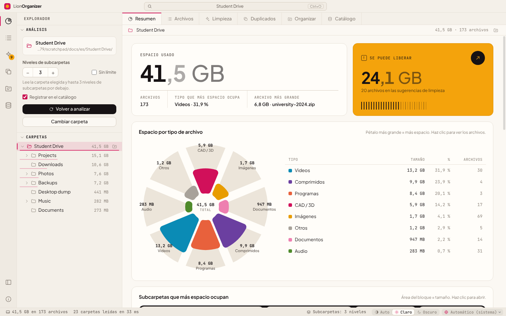

<div align="center">


# LionOrganizer

**Análisis y limpieza de espacio en disco para Windows, macOS y Linux.**<br>
Descubre qué ocupa espacio en tus carpetas, encuentra duplicados reales por su contenido y libera con seguridad lo que ya no necesitas.

<sub>por el <b>LionOrganizer Team</b> · creado e ideado por <b>Daniel Michelon De Carli</b></sub>

[English](../README.md) · [Português (Brasil)](README.pt-BR.md) · [Português (Portugal)](README.pt-PT.md) · **Español** · [Français](README.fr.md) · [Deutsch](README.de.md) · [Italiano](README.it.md) · [简体中文](README.zh-CN.md) · [日本語](README.ja.md) · [한국어](README.ko.md)


<p>
  <a href="https://github.com/danielcarli/lionorganizer/releases/latest/download/LionOrganizer-Setup.exe"></a>
  <a href="https://github.com/danielcarli/lionorganizer/releases/latest/download/LionOrganizer-mac-universal.dmg"></a>
  <a href="https://github.com/danielcarli/lionorganizer/releases/latest/download/lionorganizer_amd64.deb"></a>
  <a href="https://github.com/danielcarli/lionorganizer/releases/latest/download/lionorganizer.x86_64.rpm"></a>
  <a href="https://github.com/danielcarli/lionorganizer/releases/latest/download/LionOrganizer-x86_64.AppImage"></a>
</p>

<sub><a href="https://github.com/danielcarli/lionorganizer/releases">Todas las versiones</a> · <a href="#descargar">Cómo instalar</a></sub>



</div>

## ¿Por qué LionOrganizer?

Los analizadores de disco te dicen *qué* es grande. LionOrganizer también te ayuda a decidir *qué puede irse*, y se asegura de que nada se elimine por accidente. Nació de un problema muy concreto: los proyectos de arquitectura y diseño acumulan copias de seguridad de CAD (`.skb`, `.0001.rvt`, `.bak`), renders, videos y copias de copias hasta que el disco se llena.

Todo se ejecuta **localmente**. No hay cuenta ni telemetría; la única conexión es la búsqueda opcional de nuevas versiones.

**Lo que hace diferente a LionOrganizer**

- **Ayuda a decidir, no solo a medir** — sugerencias de limpieza agrupadas por motivo, incluidas las copias de seguridad de CAD/BIM que se acumulan en los proyectos de arquitectura (SketchUp `.skb`, Revit `.0001.rvt`, AutoCAD `.bak`).
- **Nada se elimina por error** — cada eliminación pide un código que escribes, verificado por la propia app, y los archivos van a la Papelera de reciclaje.
- **Duplicados de verdad, por contenido** — confirmados con SHA-256, y tú eliges qué copia conservar.
- **Memoria entre análisis** — un catálogo local para buscar en todas las carpetas analizadas (incluso discos desconectados) y ver qué es nuevo, qué se eliminó o qué creció.
- **Organizar y renombrar, con deshacer** — archivos sueltos ordenados en carpetas por tipo y renombrado por lotes con patrones, siempre con vista previa.
- **Una segunda opinión de la IA** — exporta un informe en tu idioma para que una IA indique qué es probablemente más seguro eliminar; la app no envía nada. Después pega su respuesta: los archivos que cita aparecen con el riesgo que les dio, listos para revisar.
- **Detecta cuando los archivos desaparecen** — los archivos eliminados o movidos fuera de la app aparecen en gris, y puedes quitarlos de las listas.
- **Para todos** — 10 idiomas, temas claro y oscuro e instaladores verificados para Windows, macOS y Linux.

## Descargar

Descarga el instalador de tu sistema. Todos obtienen la **última versión** de GitHub y verifican cada archivo (SHA-256 y procedencia firmada de la compilación).

- **Windows 10/11** (x64, ARM): asistente de instalación de unos 2 MB, que descarga y verifica el programa durante la instalación. → [`LionOrganizer-Setup.exe`](https://github.com/danielcarli/lionorganizer/releases/latest/download/LionOrganizer-Setup.exe)
- **macOS 11+** (Apple Silicon, Intel): abre el `.dmg` y arrastra LionOrganizer a Aplicaciones. → [`LionOrganizer-mac-universal.dmg`](https://github.com/danielcarli/lionorganizer/releases/latest/download/LionOrganizer-mac-universal.dmg)
- **Linux** (x64): `.deb` para Ubuntu, Debian, Mint…, `.rpm` para Fedora, RHEL, openSUSE…, o el AppImage, que funciona en cualquier distribución sin instalación. → [`.deb`](https://github.com/danielcarli/lionorganizer/releases/latest/download/lionorganizer_amd64.deb) · [`.rpm`](https://github.com/danielcarli/lionorganizer/releases/latest/download/lionorganizer.x86_64.rpm) · [AppImage](https://github.com/danielcarli/lionorganizer/releases/latest/download/LionOrganizer-x86_64.AppImage)

> Los instaladores aún no están firmados con un certificado de pago. La primera vez, Windows puede mostrar "Windows protegió tu PC" (**Más información › Ejecutar de todas formas**) y macOS pide permitir la app en **Ajustes del Sistema › Privacidad y seguridad › Abrir igualmente**.

**¿Prefieres la terminal?** Windows (PowerShell, sin permisos de administrador):

```powershell
irm https://github.com/danielcarli/lionorganizer/releases/latest/download/install.ps1 | iex
```

macOS y Linux:

```bash
curl -fsSL https://github.com/danielcarli/lionorganizer/releases/latest/download/install.sh | bash
```

[Todas las versiones](https://github.com/danielcarli/lionorganizer/releases) · [Guía de instalación](INSTALL.md) (en inglés): detalles, seguridad, actualización y desinstalación.

## Características

| | |
|---|---|
| **Analizar** | Recorre una carpeta y sus subcarpetas: 3 niveles de profundidad de forma predeterminada, configurable hasta 50 niveles o sin límite. Árbol de carpetas con tamaños, ruta de navegación y una tabla de todos los archivos que se puede ordenar y filtrar. |
| **Carpetas grandes** | El último análisis se reabre al instante desde el catálogo, marcado con su fecha, mientras la carpeta se vuelve a analizar en segundo plano. Lista opcional de carpetas que ignorar (`node_modules`, `.git`, carpetas del sistema), desactivada por defecto. Los elementos que el sistema no dejó leer aparecen con el motivo; en Windows se puede volver a analizar como administrador. |
| **Visualizar** | Espacio por tipo de archivo (gráfico de rosa), subcarpetas más grandes (treemap), una matriz de 100 puntos en la que cada punto es el 1 % del espacio, las extensiones que más ocupan y la antigüedad de los archivos. |
| **Mapa de espacio** | Treemap a pantalla completa: cada archivo es un bloque, anidado en sus carpetas y coloreado por tipo. Haz clic en un bloque para entrar en su carpeta; Retroceso o el clic derecho sube. |
| **Limpiar** | Sugerencias agrupadas por motivo: copias de seguridad de SketchUp/Revit/AutoCAD, archivos temporales, registros, descargas incompletas, instaladores, archivos grandes y antiguos. |
| **Más para limpiar** | Cachés de render y CAD (Twinmotion, Lumion, Enscape, V-Ray, Corona, journals de Revit, Media Cache de Adobe), archivos vacíos y carpetas vacías; las carpetas también van a la Papelera solo tras escribir el código. |
| **Duplicados reales** | Comparación de contenido con SHA-256, leyendo solo lo necesario (tamaño → primeros/últimos 64 KB → archivo completo). Elige qué copia conservar; mira cuándo el mismo archivo también existe en otra carpeta catalogada (por ejemplo, un disco de copias de seguridad). |
| **Organizar** | Mueve los archivos sueltos a subcarpetas por tipo y cambia nombres en lote con patrones como `{date}-{n}-{name}`. Siempre con vista previa, y se puede deshacer. |
| **Catálogo e historial** | Un catálogo SQLite local con nombres, tamaños, fechas y hashes. Busca en todas las carpetas que hayas analizado, incluso en unidades desconectadas, y compara análisis para ver qué es nuevo, qué se eliminó o qué está creciendo. |
| **10 idiomas** | English, Português (Brasil), Português (Portugal), Español, Français, Deutsch, Italiano, 简体中文, 日本語, 한국어: se detecta a partir del sistema y se puede cambiar en la barra de estado. |
| **Claro y oscuro** | Tema automático o manual, con una paleta de colores comprobada para deficiencias en la visión del color. |

## La seguridad, lo primero

Eliminar el archivo equivocado es peor que tener el disco lleno, así que LionOrganizer es cuidadoso a propósito:

- **Código de confirmación escrito.** Toda acción que modifica archivos —*cualquier* eliminación (de un archivo o de muchos), organizar, cambiar nombres, deshacer y vaciar el catálogo— muestra un código de 6 caracteres que hay que **escribir** (pegar está desactivado) para que se habilite el botón. El código lo genera y lo comprueba el proceso principal, así que la interfaz no puede saltárselo. Cinco intentos fallidos cancelan la operación.
- **Papelera de reciclaje, no eliminación permanente.** Los archivos eliminados van a la Papelera de reciclaje de Windows.
- **Acciones acotadas.** El proceso principal solo toca archivos que pertenecen a la carpeta analizada y que aparecieron en el último análisis.
- **Deshacer.** Las operaciones de organizar y cambiar nombre quedan registradas y se pueden revertir desde *Catálogo → Operaciones recientes*.
- **Solo lectura de forma predeterminada.** Analizar y buscar duplicados nunca modifican nada.

<div align="center">

</div>

## Capturas de pantalla

| | |
|---|---|
|  **Duplicados**: copias idénticas agrupadas por SHA-256 |  **Limpieza**: sugerencias agrupadas por motivo |
|  **Organizar**: por tipo y cambio de nombre en lote, con vista previa |  **Catálogo**: búsqueda, historial y deshacer |
|  **Archivos**: todos los archivos, con orden y filtros |  **Tema oscuro** |

Las demás capturas de pantalla muestran la interfaz en inglés.

<div align="center">

<br><sub>La misma pantalla en los diez idiomas disponibles.</sub>
</div>

## Primeros pasos

### Ejecutar desde el código fuente (Windows)

1. Instala [Node.js LTS](https://nodejs.org).
2. Descarga o clona este repositorio.
3. Haz doble clic en **`start.bat`**: la primera ejecución instala las dependencias.

O desde una terminal:

```powershell
npm install
npm start
```

> En PowerShell, si los scripts están deshabilitados, usa `npm.cmd` en lugar de `npm`.

### Crear un instalador

Haz doble clic en **`build-installer.bat`** (o ejecuta `npm run dist`). Se crean un instalador y un `.exe` portable en `dist/`.

## Atajos de teclado

| Atajo | Acción |
|---|---|
| `Ctrl+O` | Abrir carpeta |
| `F5` | Volver a analizar |
| `Ctrl+1` … `Ctrl+7` | Resumen · Archivos · Limpieza · Duplicados · Organizar · Catálogo · Mapa de espacio |
| `Ctrl+B` | Mostrar/ocultar barra lateral |
| `Esc` | Cancelar el análisis o la búsqueda de duplicados en curso |

## Idiomas

| Idioma | Código | | Idioma | Código |
|---|---|---|---|---|
| English | `en` | | Deutsch | `de` |
| Português (Brasil) | `pt-BR` | | Italiano | `it` |
| Português (Portugal) | `pt-PT` | | 简体中文 | `zh-CN` |
| Español | `es` | | 日本語 | `ja` |
| Français | `fr` | | 한국어 | `ko` |

De forma predeterminada, el idioma sigue al de Windows y se puede cambiar en la barra de estado. Los números, las fechas y las unidades de tamaño siguen el idioma elegido (por ejemplo, en francés se muestran *Mo* y *Go*). Las traducciones que falten se muestran en inglés.

¿Quieres añadir o mejorar un idioma? Consulta [CONTRIBUTING.md](../CONTRIBUTING.md#translations): solo hace falta un archivo JSON.

## Privacidad

LionOrganizer funciona sin conexión. Su única conexión es la búsqueda de nuevas versiones: lee un archivo pequeño de las versiones publicadas del proyecto en GitHub y no envía ningún dato sobre ti ni sobre tus archivos. Puedes desactivarla haciendo clic en el número de versión, en la esquina inferior derecha. La app nunca envía el informe de *Exportar para IA*: tú eliges dónde pegarlo.

El catálogo es un único archivo en tu equipo:

```
%APPDATA%\LionOrganizer\catalog.sqlite
```

Puedes desactivar el registro («Registrar en el catálogo», en la barra lateral), exportarlo a CSV o vaciarlo desde la vista *Catálogo* en cualquier momento. Vaciar el catálogo nunca elimina tus archivos.

## Arquitectura

El código sigue la organización en capas de [Visual Studio Code](https://github.com/microsoft/vscode): `base` no sabe nada de lo que está por encima, `platform` ofrece los servicios del sistema y `workbench` construye la interfaz. El proceso principal (Node.js) y la interfaz (un renderer en sandbox sin acceso a Node) solo se comunican a través del puente `preload`.

```
src/
  base/
    common/              pure utilities: events, formatting, i18n (nls.js)
    browser/             DOM helpers, icons, charts (rose, treemap, dot matrix, bars, hatched columns)
  platform/              main-process services
    files/               folder scanner with depth limit
    catalog/             SQLite catalog, history, operation log, duplicate finder (SHA-256)
    operations/          file-changing operations guarded by the typed confirmation code
    shell/ · dialogs/    Explorer integration, native dialogs
    nls/                 i18n for the main process
  code/
    electron-main/       entry point: window, app:// protocol, service wiring
    electron-sandbox/    preload bridge
  nls/                   message catalogs: en.json, pt-BR.json, … (one file per language)
  workbench/
    browser/             bootstrap, layout parts (title bar, activity bar, side bar, editor, status bar), styles
    services/            analysis model, scan, layout, notifications, operations, confirmation, duplicates, catalog
    contrib/             views: overview, files, cleanup, duplicates, organize, catalog
```

Seguridad: `contextIsolation` y `sandbox` activados, sin `nodeIntegration`, una Content Security Policy estricta, y cada solicitud que modifica archivos se valida en el proceso principal.

## Desarrollo

| Comando | Qué hace |
|---|---|
| `npm start` | Ejecuta la aplicación |
| `npm run dist` | Crea el instalador de Windows y la aplicación portable |
| `npm run test:e2e` | Prueba de extremo a extremo: analiza una carpeta **desechable** y pone a prueba duplicados, eliminación, organizar, cambiar nombre, deshacer y el catálogo, comprobando los resultados en el disco |
| `npm run docs:screenshots` | Vuelve a generar las capturas de pantalla de `docs/screenshots` |

```powershell
# the end-to-end test changes files: always point it to a throwaway folder
$env:E2E_FOLDER="C:\temp\lion-test"; $env:E2E_OUT="C:\temp\lion-out"; npm run test:e2e
```

## Cómo contribuir

Los informes de errores, las ideas y los pull requests son bienvenidos, sobre todo las traducciones. Lee [CONTRIBUTING.md](../CONTRIBUTING.md).

## Créditos

LionOrganizer fue **creado e ideado por Daniel Michelon De Carli**, estudiante de Arquitectura y Urbanismo, y lo mantiene el **LionOrganizer Team** junto con sus colaboradores y traductores.

Fuentes incluidas: [Plus Jakarta Sans](https://github.com/tokotype/PlusJakartaSans) y [JetBrains Mono](https://github.com/JetBrains/JetBrainsMono), bajo la SIL Open Font License. La arquitectura está inspirada en [Visual Studio Code](https://github.com/microsoft/vscode).

## Licencia

Copyright © 2026 LionOrganizer Team.

LionOrganizer es software libre: puedes redistribuirlo y/o modificarlo según los términos de la **[GNU General Public License v3.0](../LICENSE)** publicada por la Free Software Foundation, ya sea la versión 3 de la Licencia o (a tu elección) cualquier versión posterior. Se distribuye con la esperanza de que sea útil, pero **sin ninguna garantía**; consulta la licencia para más detalles.

En resumen: puedes usar, estudiar, compartir y modificar LionOrganizer libremente; si distribuyes una versión modificada, también debe publicarse bajo la GPL junto con su código fuente.

Esta traducción es solo informativa: el texto de la licencia en inglés, en el archivo [LICENSE](../LICENSE), es el único jurídicamente vinculante.
