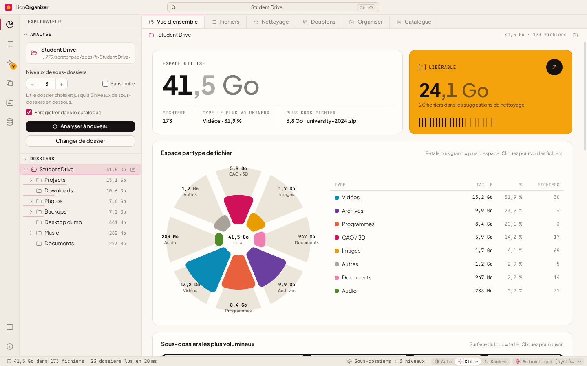

<div align="center">


# LionOrganizer

**Analyse et nettoyage de l’espace disque pour Windows, macOS et Linux.**<br>
Voyez ce qui occupe de l’espace dans vos dossiers, trouvez les vrais doublons par leur contenu et libérez en toute sécurité ce dont vous n’avez plus besoin.

<sub>par la <b>LionOrganizer Team</b> · créé et conçu par <b>Daniel Michelon De Carli</b></sub>

[English](../README.md) · [Português (Brasil)](README.pt-BR.md) · [Português (Portugal)](README.pt-PT.md) · [Español](README.es.md) · **Français** · [Deutsch](README.de.md) · [Italiano](README.it.md) · [简体中文](README.zh-CN.md) · [日本語](README.ja.md) · [한국어](README.ko.md)


<p>
  <a href="https://github.com/danielcarli/lionorganizer/releases/latest/download/LionOrganizer-Setup.exe"></a>
  <a href="https://github.com/danielcarli/lionorganizer/releases/latest/download/LionOrganizer-mac-universal.dmg"></a>
  <a href="https://github.com/danielcarli/lionorganizer/releases/latest/download/lionorganizer_amd64.deb"></a>
  <a href="https://github.com/danielcarli/lionorganizer/releases/latest/download/lionorganizer.x86_64.rpm"></a>
  <a href="https://github.com/danielcarli/lionorganizer/releases/latest/download/LionOrganizer-x86_64.AppImage"></a>
</p>

<sub><a href="https://github.com/danielcarli/lionorganizer/releases">Toutes les versions</a> · <a href="#télécharger">Comment installer</a></sub>



</div>

## Pourquoi LionOrganizer ?

Les analyseurs de disque vous disent *ce qui* est volumineux. LionOrganizer vous aide aussi à décider *ce qui peut partir* — et veille à ce que rien ne soit supprimé par accident. Il est né d’un problème très concret : les projets d’architecture et de design accumulent les sauvegardes CAO (`.skb`, `.0001.rvt`, `.bak`), les rendus, les vidéos et les copies de copies jusqu’à ce que le disque soit plein.

Tout fonctionne **en local**. Pas de compte ni de télémétrie ; la seule connexion est une recherche facultative de nouvelles versions.

**Ce qui distingue LionOrganizer**

- **Il aide à décider, pas seulement à mesurer** — des suggestions de nettoyage groupées par raison, y compris les sauvegardes CAO/BIM qui s’accumulent dans les projets d’architecture (SketchUp `.skb`, Revit `.0001.rvt`, AutoCAD `.bak`).
- **Rien n’est supprimé par erreur** — chaque suppression demande un code à saisir, vérifié par l’application elle-même, et les fichiers vont à la Corbeille.
- **De vrais doublons, par le contenu** — confirmés par SHA-256, et vous choisissez la copie à garder.
- **Une mémoire entre les analyses** — un catalogue local pour chercher dans tous les dossiers analysés (même des disques débranchés) et voir ce qui est nouveau, supprimé ou en hausse.
- **Ranger et renommer, avec annulation** — les fichiers en vrac classés dans des dossiers par type et le renommage par lots avec des modèles, toujours avec un aperçu.
- **Un deuxième avis par l’IA** — exportez un rapport dans votre langue pour qu’une IA indique ce qui est probablement le plus sûr à supprimer ; l’application n’envoie rien. Collez ensuite sa réponse : les fichiers cités s’affichent avec le risque indiqué, prêts à être vérifiés.
- **Il voit quand des fichiers disparaissent** — les fichiers supprimés ou déplacés en dehors de l’application apparaissent en gris, et vous pouvez les retirer des listes.
- **Pour tout le monde** — 10 langues, thèmes clair et sombre, et des installateurs vérifiés pour Windows, macOS et Linux.

## Télécharger

Téléchargez l'installateur de votre système. Chacun récupère la **dernière version** sur GitHub et vérifie chaque fichier (SHA-256 et provenance signée du build).

- **Windows 10/11** (x64, ARM) : assistant d'installation d'environ 2 Mo, qui télécharge et vérifie le programme pendant l'installation. → [`LionOrganizer-Setup.exe`](https://github.com/danielcarli/lionorganizer/releases/latest/download/LionOrganizer-Setup.exe)
- **macOS 11+** (Apple Silicon, Intel) : ouvrez le `.dmg` et glissez LionOrganizer dans Applications. → [`LionOrganizer-mac-universal.dmg`](https://github.com/danielcarli/lionorganizer/releases/latest/download/LionOrganizer-mac-universal.dmg)
- **Linux** (x64) : `.deb` pour Ubuntu, Debian, Mint…, `.rpm` pour Fedora, RHEL, openSUSE…, ou l'AppImage, qui fonctionne sur toute distribution sans installation. → [`.deb`](https://github.com/danielcarli/lionorganizer/releases/latest/download/lionorganizer_amd64.deb) · [`.rpm`](https://github.com/danielcarli/lionorganizer/releases/latest/download/lionorganizer.x86_64.rpm) · [AppImage](https://github.com/danielcarli/lionorganizer/releases/latest/download/LionOrganizer-x86_64.AppImage)

> Les installateurs ne sont pas encore signés avec un certificat payant. Au premier lancement, Windows peut afficher « Windows a protégé votre ordinateur » (**Informations complémentaires › Exécuter quand même**) et macOS demande d'autoriser l'app dans **Réglages Système › Confidentialité et sécurité › Ouvrir quand même**.

**Vous préférez le terminal ?** Windows (PowerShell, sans droits administrateur) :

```powershell
irm https://github.com/danielcarli/lionorganizer/releases/latest/download/install.ps1 | iex
```

macOS et Linux :

```bash
curl -fsSL https://github.com/danielcarli/lionorganizer/releases/latest/download/install.sh | bash
```

[Toutes les versions](https://github.com/danielcarli/lionorganizer/releases) · [Guide d’installation](INSTALL.md) (en anglais) : détails, sécurité, mise à jour et désinstallation.

## Fonctionnalités

| | |
|---|---|
| **Analyser** | Parcourt un dossier et ses sous-dossiers — 3 niveaux par défaut, jusqu’à 50 niveaux ou sans limite. Arborescence des dossiers avec leurs tailles, fil d’Ariane et tableau triable et filtrable de tous les fichiers. |
| **Grands dossiers** | La dernière analyse se rouvre instantanément depuis le catalogue, avec sa date ; le dossier n’est réanalysé que si vous le demandez, en arrière-plan. L’espace analysé est affiché à côté de l’espace utilisé sur le disque, avec la raison de l’écart (éléments inaccessibles, limite de niveaux, fichiers système). Liste facultative de dossiers à ignorer (`node_modules`, `.git`, dossiers système) — désactivée par défaut. Les éléments que le système n’a pas laissé lire sont listés avec la raison ; sous Windows, on peut analyser à nouveau en tant qu’administrateur. |
| **Visualiser** | Espace par type de fichier (diagramme en rose), plus gros sous-dossiers (treemap), matrice de 100 points où chaque point représente 1 % de l’espace, extensions les plus volumineuses et ancienneté des fichiers. |
| **Carte de l’espace** | Treemap en plein écran : chaque fichier est un bloc, imbriqué dans ses dossiers et coloré selon son type. Cliquez sur un bloc pour entrer dans son dossier ; Retour arrière ou le clic droit remonte. |
| **Nettoyer** | Suggestions regroupées par motif : sauvegardes SketchUp/Revit/AutoCAD, fichiers temporaires, journaux, téléchargements inachevés, programmes d’installation, gros fichiers anciens. |
| **Encore plus à nettoyer** | Caches de rendu et de CAO (Twinmotion, Lumion, Enscape, V-Ray, Corona, journaux Revit, Media Cache d’Adobe), fichiers vides et dossiers vides — les dossiers ne vont eux aussi dans la Corbeille qu’après le code saisi. |
| **Vrais doublons** | Comparaison du contenu avec SHA-256, lu seulement quand c’est nécessaire (taille → 64 Ko de début et de fin → fichier entier). Choisissez la copie à conserver ; voyez si le même fichier existe aussi dans un autre dossier catalogué (par exemple un disque de sauvegarde). |
| **Organiser** | Rangez les fichiers en vrac dans des sous-dossiers par type et renommez par lot avec des modèles comme `{date}-{n}-{name}`. Toujours avec un aperçu, et annulable. |
| **Catalogue et historique** | Un catalogue SQLite local des noms, tailles, dates et hachages. Recherchez dans tous les dossiers que vous avez analysés — même sur des disques débranchés — et comparez les analyses pour voir ce qui est nouveau, supprimé ou en hausse. |
| **10 langues** | English, Português (Brasil), Português (Portugal), Español, Français, Deutsch, Italiano, 简体中文, 日本語, 한국어 — détectée depuis le système, modifiable dans la barre d’état. |
| **Clair et sombre** | Thème automatique ou manuel, avec une palette de couleurs vérifiée pour les déficiences de la vision des couleurs. |

## La sécurité avant tout

Supprimer le mauvais fichier est pire qu’un disque plein ; LionOrganizer est donc volontairement prudent :

- **Code de confirmation à saisir.** Chaque action qui modifie des fichiers — *toute* suppression (un fichier ou plusieurs), l’organisation, le renommage, l’annulation et la suppression du catalogue — affiche un code de 6 caractères qui doit être **saisi au clavier** (le collage est désactivé) avant que le bouton se déverrouille. Le code est généré et vérifié par le processus principal : l’interface ne peut donc pas le contourner. Cinq tentatives erronées annulent l’opération.
- **La Corbeille, pas de suppression définitive.** Les fichiers supprimés vont dans la Corbeille de Windows.
- **Actions circonscrites.** Le processus principal ne touche qu’aux fichiers qui appartiennent au dossier analysé et qui ont été vus lors de la dernière analyse.
- **Annulation.** Les opérations d’organisation et de renommage sont journalisées et peuvent être annulées depuis *Catalogue → Opérations récentes*.
- **Lecture seule par défaut.** L’analyse et la recherche de doublons ne modifient jamais rien.

<div align="center">

</div>

## Captures d’écran

| | |
|---|---|
|  **Doublons** — copies identiques regroupées par SHA-256 |  **Nettoyage** — suggestions regroupées par motif |
|  **Organiser** — par type et renommage par lot, avec aperçu |  **Catalogue** — recherche, historique et annulation |
|  **Fichiers** — tous les fichiers, triables et filtrables |  **Thème sombre** |

<sub>À l’exception de l’image en haut de page, ces captures montrent l’interface en anglais.</sub>

<div align="center">

<br><sub>Le même écran dans les dix langues prises en charge.</sub>
</div>

## Premiers pas

### Exécuter depuis les sources (Windows)

1. Installez [Node.js LTS](https://nodejs.org).
2. Téléchargez ou clonez ce dépôt.
3. Double-cliquez sur **`start.bat`** — la première exécution installe les dépendances.

Ou depuis un terminal :

```powershell
npm install
npm start
```

> Dans PowerShell, si les scripts sont désactivés, utilisez `npm.cmd` au lieu de `npm`.

### Créer un programme d’installation

Double-cliquez sur **`build-installer.bat`** (ou exécutez `npm run dist`). Un programme d’installation et un `.exe` portable sont créés dans `dist/`.

## Raccourcis clavier

| Raccourci | Action |
|---|---|
| `Ctrl+O` | Ouvrir un dossier |
| `F5` | Analyser à nouveau |
| `Ctrl+1` … `Ctrl+7` | Vue d’ensemble · Fichiers · Nettoyage · Doublons · Organiser · Catalogue · Carte de l’espace |
| `Ctrl+B` | Afficher/masquer la barre latérale |
| `Esc` | Annuler l’analyse ou la recherche de doublons en cours |

## Langues

| Langue | Code | | Langue | Code |
|---|---|---|---|---|
| English | `en` | | Deutsch | `de` |
| Português (Brasil) | `pt-BR` | | Italiano | `it` |
| Português (Portugal) | `pt-PT` | | 简体中文 | `zh-CN` |
| Español | `es` | | 日本語 | `ja` |
| Français | `fr` | | 한국어 | `ko` |

Par défaut, la langue suit celle de Windows ; elle peut être modifiée dans la barre d’état. Les nombres, les dates et les unités de taille suivent la langue choisie (par exemple, le français affiche *Mo* et *Go*). Les traductions manquantes sont remplacées par l’anglais.

Vous souhaitez ajouter ou améliorer une langue ? Consultez [CONTRIBUTING.md](../CONTRIBUTING.md#translations) — un simple fichier JSON suffit.

## Confidentialité

LionOrganizer fonctionne hors ligne. Sa seule connexion est la recherche de nouvelles versions : elle lit un petit fichier parmi les versions publiées du projet sur GitHub et n’envoie aucune donnée sur vous ni sur vos fichiers. Vous pouvez la désactiver en cliquant sur le numéro de version, en bas à droite. L’application n’envoie jamais le rapport *Exporter pour l’IA* : c’est vous qui choisissez où le coller.

Le catalogue est un fichier unique sur votre ordinateur :

```
%APPDATA%\LionOrganizer\catalog.sqlite
```

Vous pouvez à tout moment désactiver l’enregistrement (« Enregistrer dans le catalogue » dans la barre latérale), l’exporter en CSV ou le vider depuis la vue *Catalogue*. Vider le catalogue ne supprime jamais vos fichiers.

## Architecture

Le code suit le découpage en couches de [Visual Studio Code](https://github.com/microsoft/vscode) : `base` ne connaît rien de ce qui se trouve au-dessus, `platform` fournit les services système et `workbench` construit l’interface. Le processus principal (Node.js) et l’interface (un renderer isolé dans un bac à sable, sans accès à Node) ne communiquent que par le pont `preload`.

```
src/
  base/
    common/              pure utilities: events, formatting, i18n (nls.js)
    browser/             DOM helpers, icons, charts (rose, treemap, dot matrix, bars, hatched columns)
  platform/              main-process services
    files/               folder scanner with depth limit
    catalog/             SQLite catalog, history, operation log, duplicate finder (SHA-256)
    operations/          file-changing operations guarded by the typed confirmation code
    shell/ · dialogs/    Explorer integration, native dialogs
    nls/                 i18n for the main process
  code/
    electron-main/       entry point: window, app:// protocol, service wiring
    electron-sandbox/    preload bridge
  nls/                   message catalogs: en.json, pt-BR.json, … (one file per language)
  workbench/
    browser/             bootstrap, layout parts (title bar, activity bar, side bar, editor, status bar), styles
    services/            analysis model, scan, layout, notifications, operations, confirmation, duplicates, catalog
    contrib/             views: overview, files, cleanup, duplicates, organize, catalog
```

Sécurité : `contextIsolation` et `sandbox` activés, pas de `nodeIntegration`, une Content Security Policy stricte, et chaque requête qui modifie des fichiers est validée dans le processus principal.

## Développement

| Commande | Ce qu’elle fait |
|---|---|
| `npm start` | Lance l’application |
| `npm run dist` | Crée le programme d’installation Windows et l’application portable |
| `npm run test:e2e` | Test de bout en bout : analyse un dossier **jetable** et exerce les doublons, la suppression, l’organisation, le renommage, l’annulation et le catalogue, en vérifiant les résultats sur le disque |
| `npm run docs:screenshots` | Régénère les captures d’écran dans `docs/screenshots` |

```powershell
# the end-to-end test changes files: always point it to a throwaway folder
$env:E2E_FOLDER="C:\temp\lion-test"; $env:E2E_OUT="C:\temp\lion-out"; npm run test:e2e
```

## Contribuer

Les rapports de bogues, les idées et les pull requests sont les bienvenus — en particulier les traductions. Veuillez lire [CONTRIBUTING.md](../CONTRIBUTING.md).

## Crédits

LionOrganizer a été **créé et conçu par Daniel Michelon De Carli**, étudiant en architecture et urbanisme, et est maintenu par la **LionOrganizer Team** avec ses contributeurs et traducteurs.

Polices incluses : [Plus Jakarta Sans](https://github.com/tokotype/PlusJakartaSans) et [JetBrains Mono](https://github.com/JetBrains/JetBrainsMono), sous licence SIL Open Font License. L’architecture s’inspire de [Visual Studio Code](https://github.com/microsoft/vscode).

## Licence

Copyright © 2026 LionOrganizer Team.

LionOrganizer est un logiciel libre : vous pouvez le redistribuer et/ou le modifier selon les termes de la **[GNU General Public License v3.0](../LICENSE)** telle que publiée par la Free Software Foundation, soit la version 3 de la licence, soit (à votre choix) toute version ultérieure. Il est distribué dans l’espoir qu’il sera utile, mais **sans aucune garantie** ; consultez la licence pour plus de détails.

En bref : vous pouvez utiliser, étudier, partager et modifier LionOrganizer librement ; si vous distribuez une version modifiée, elle doit elle aussi être publiée sous la GPL avec son code source.

Ce résumé n’est fourni qu’à titre informatif : seul le texte anglais de la licence, dans le fichier [LICENSE](../LICENSE), fait juridiquement foi.
