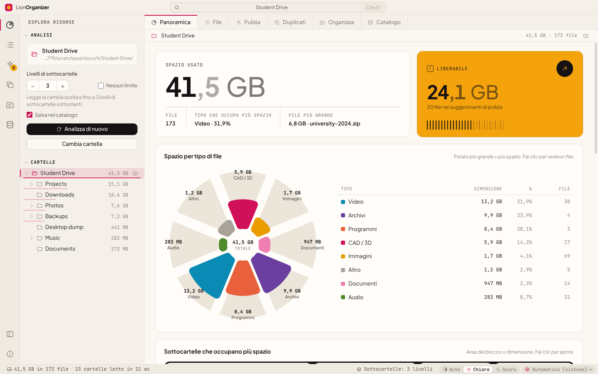

<div align="center">


# LionOrganizer

**Analisi e pulizia dello spazio su disco per Windows, macOS e Linux.**<br>
Scopri cosa occupa spazio nelle tue cartelle, trova i veri duplicati in base al contenuto e libera in sicurezza ciò che non ti serve più.

<sub>dal <b>LionOrganizer Team</b> · ideato e creato da <b>Daniel Michelon De Carli</b></sub>

[English](../README.md) · [Português (Brasil)](README.pt-BR.md) · [Português (Portugal)](README.pt-PT.md) · [Español](README.es.md) · [Français](README.fr.md) · [Deutsch](README.de.md) · **Italiano** · [简体中文](README.zh-CN.md) · [日本語](README.ja.md) · [한국어](README.ko.md)


<p>
  <a href="https://github.com/danielcarli/lionorganizer/releases/latest/download/LionOrganizer-Setup.exe"></a>
  <a href="https://github.com/danielcarli/lionorganizer/releases/latest/download/LionOrganizer-mac-universal.dmg"></a>
  <a href="https://github.com/danielcarli/lionorganizer/releases/latest/download/lionorganizer_amd64.deb"></a>
  <a href="https://github.com/danielcarli/lionorganizer/releases/latest/download/lionorganizer.x86_64.rpm"></a>
  <a href="https://github.com/danielcarli/lionorganizer/releases/latest/download/LionOrganizer-x86_64.AppImage"></a>
</p>

<sub><a href="https://github.com/danielcarli/lionorganizer/releases">Tutte le versioni</a> · <a href="#download">Come installare</a></sub>



</div>

## Perché LionOrganizer?

Gli analizzatori di disco ti dicono *cosa* è grande. LionOrganizer ti aiuta anche a decidere *cosa può sparire*, e fa in modo che nulla venga eliminato per errore. È nato da un problema molto concreto: i progetti di architettura e design accumulano backup CAD (`.skb`, `.0001.rvt`, `.bak`), render, video e copie di copie finché il disco non è pieno.

Tutto viene eseguito **in locale**. Nessun account e nessuna telemetria; l’unica connessione è la ricerca facoltativa di nuove versioni.

**Cosa rende diverso LionOrganizer**

- **Aiuta a decidere, non solo a misurare** — suggerimenti di pulizia raggruppati per motivo, compresi i backup CAD/BIM che si accumulano nei progetti di architettura (SketchUp `.skb`, Revit `.0001.rvt`, AutoCAD `.bak`).
- **Niente viene eliminato per errore** — ogni eliminazione chiede un codice da digitare, verificato dall’app stessa, e i file vanno nel Cestino.
- **Duplicati veri, per contenuto** — confermati con SHA-256, e scegli tu quale copia tenere.
- **Memoria tra le analisi** — un catalogo locale per cercare in tutte le cartelle analizzate (anche dischi scollegati) e vedere cosa è nuovo, rimosso o cresciuto.
- **Organizza e rinomina, con annulla** — file sparsi ordinati in cartelle per tipo e rinomina in blocco con modelli, sempre con anteprima.
- **Un secondo parere dall’IA** — esporta un rapporto nella tua lingua perché un’IA indichi cosa è probabilmente più sicuro eliminare; l’app non invia nulla. Poi incolla la sua risposta: i file citati compaiono con il rischio indicato, pronti da controllare.
- **Si accorge quando i file spariscono** — i file eliminati o spostati fuori dall’app appaiono in grigio, e puoi rimuoverli dagli elenchi.
- **Per tutti** — 10 lingue, tema chiaro e scuro e programmi di installazione verificati per Windows, macOS e Linux.

## Download

Scarica il programma di installazione per il tuo sistema. Ognuno prende l'**ultima versione** da GitHub e verifica ogni file (SHA-256 e provenienza firmata della build).

- **Windows 10/11** (x64, ARM): installazione guidata di circa 2 MB, che scarica e verifica l'applicazione durante l'installazione. → [`LionOrganizer-Setup.exe`](https://github.com/danielcarli/lionorganizer/releases/latest/download/LionOrganizer-Setup.exe)
- **macOS 11+** (Apple Silicon, Intel): apri il `.dmg` e trascina LionOrganizer in Applicazioni. → [`LionOrganizer-mac-universal.dmg`](https://github.com/danielcarli/lionorganizer/releases/latest/download/LionOrganizer-mac-universal.dmg)
- **Linux** (x64): `.deb` per Ubuntu, Debian, Mint…, `.rpm` per Fedora, RHEL, openSUSE…, oppure l'AppImage, che funziona su qualsiasi distribuzione senza installazione. → [`.deb`](https://github.com/danielcarli/lionorganizer/releases/latest/download/lionorganizer_amd64.deb) · [`.rpm`](https://github.com/danielcarli/lionorganizer/releases/latest/download/lionorganizer.x86_64.rpm) · [AppImage](https://github.com/danielcarli/lionorganizer/releases/latest/download/LionOrganizer-x86_64.AppImage)

> I programmi di installazione non sono ancora firmati con un certificato a pagamento. Al primo avvio Windows può mostrare "PC protetto da Windows" (**Ulteriori informazioni › Esegui comunque**) e macOS chiede di consentire l'app in **Impostazioni di Sistema › Privacy e sicurezza › Apri comunque**.

**Preferisci il terminale?** Windows (PowerShell, senza diritti di amministratore):

```powershell
irm https://github.com/danielcarli/lionorganizer/releases/latest/download/install.ps1 | iex
```

macOS e Linux:

```bash
curl -fsSL https://github.com/danielcarli/lionorganizer/releases/latest/download/install.sh | bash
```

[Tutte le versioni](https://github.com/danielcarli/lionorganizer/releases) · [Guida all’installazione](INSTALL.md) (in inglese): dettagli, sicurezza, aggiornamento e disinstallazione.

## Funzionalità

| | |
|---|---|
| **Analizza** | Esamina una cartella e le sue sottocartelle: 3 livelli per impostazione predefinita, configurabile fino a 50 livelli o senza limiti. Albero delle cartelle con le dimensioni, percorso di navigazione e una tabella ordinabile e filtrabile di tutti i file. |
| **Cartelle grandi** | L’ultima analisi si riapre subito dal catalogo, con la sua data; la cartella viene rianalizzata solo quando lo chiedi, in background. Mostra lo spazio analizzato accanto allo spazio usato sul disco e il perché della differenza (elementi inaccessibili, limite di livelli, file di sistema). Elenco facoltativo di cartelle da ignorare (`node_modules`, `.git`, cartelle di sistema), disattivato per impostazione predefinita. Gli elementi che il sistema non ha lasciato leggere sono elencati con il motivo; su Windows si può analizzare di nuovo come amministratore. |
| **Visualizza** | Spazio per tipo di file (grafico a rosa), sottocartelle più grandi (treemap), una matrice di 100 punti in cui ogni punto è l'1% dello spazio, estensioni più pesanti ed età dei file. |
| **Mappa dello spazio** | Treemap a schermo intero: ogni file è un blocco, annidato nelle sue cartelle e colorato per tipo. Fai clic su un blocco per entrare nella sua cartella; Backspace o il clic destro risale. |
| **Pulizia** | Suggerimenti raggruppati per motivo: backup di SketchUp/Revit/AutoCAD, file temporanei, log, download non completati, programmi di installazione, file grandi e vecchi. |
| **Altro da pulire** | Cache di render e CAD (Twinmotion, Lumion, Enscape, V-Ray, Corona, journal di Revit, Media Cache di Adobe), file vuoti e cartelle vuote: anche le cartelle vanno nel Cestino solo dopo il codice digitato. |
| **Veri duplicati** | Confronto del contenuto con SHA-256, letto solo quando serve (dimensione → primi/ultimi 64 KB → file intero). Scegli quale copia mantenere; scopri se lo stesso file esiste anche in un'altra cartella catalogata (ad esempio un disco di backup). |
| **Organizza** | Sposta i file sparsi in sottocartelle per tipo e rinomina in blocco con schemi come `{date}-{n}-{name}`. Sempre con anteprima e annullabile. |
| **Catalogo e cronologia** | Un catalogo SQLite locale di nomi, dimensioni, date e hash. Cerca in tutte le cartelle che hai analizzato, anche su dischi scollegati, e confronta le scansioni per vedere cosa è nuovo, rimosso o in crescita. |
| **10 lingue** | English, Português (Brasil), Português (Portugal), Español, Français, Deutsch, Italiano, 简体中文, 日本語, 한국어: rilevata dal sistema, modificabile dalla barra di stato. |
| **Chiaro e scuro** | Tema automatico o manuale, con una tavolozza di colori verificata per le discromatopsie. |

## Prima di tutto la sicurezza

Eliminare il file sbagliato è peggio di un disco pieno, per questo LionOrganizer è volutamente prudente:

- **Codice di conferma da digitare.** Ogni azione che modifica i file (*qualsiasi* eliminazione, di uno o più file, organizzazione, ridenominazione, annullamento e svuotamento del catalogo) mostra un codice di 6 caratteri che deve essere **digitato** (incollare è disattivato) prima che il pulsante si sblocchi. Il codice viene generato e verificato dal processo principale, quindi l'interfaccia non può saltarlo. Cinque tentativi errati annullano l'operazione.
- **Cestino, non eliminazione definitiva.** I file eliminati finiscono nel Cestino di Windows.
- **Azioni circoscritte.** Il processo principale tocca solo i file che appartengono alla cartella analizzata e che sono stati rilevati nell'ultima scansione.
- **Annulla.** Le operazioni di organizzazione e ridenominazione vengono registrate e possono essere annullate da *Catalogo → Operazioni recenti*.
- **Sola lettura per impostazione predefinita.** L'analisi e la ricerca dei duplicati non modificano mai nulla.

<div align="center">

</div>

## Screenshot

| | |
|---|---|
|  **Duplicati**: copie identiche raggruppate per SHA-256 |  **Pulizia**: suggerimenti raggruppati per motivo |
|  **Organizza**: per tipo e rinomina in blocco, con anteprima |  **Catalogo**: ricerca, cronologia e annullamento |
|  **File**: tutti i file, ordinabili e filtrabili |  **Tema scuro** |

<sub>A parte l'immagine in alto, gli screenshot mostrano l'interfaccia in inglese.</sub>

<div align="center">

<br><sub>La stessa schermata nelle dieci lingue supportate.</sub>
</div>

## Per iniziare

### Eseguire dal codice sorgente (Windows)

1. Installa [Node.js LTS](https://nodejs.org).
2. Scarica o clona questo repository.
3. Fai doppio clic su **`start.bat`**: al primo avvio vengono installate le dipendenze.

Oppure da un terminale:

```powershell
npm install
npm start
```

> In PowerShell, se gli script sono disattivati, usa `npm.cmd` invece di `npm`.

### Creare un programma di installazione

Fai doppio clic su **`build-installer.bat`** (oppure esegui `npm run dist`). In `dist/` vengono creati un programma di installazione e un `.exe` portatile.

## Scorciatoie da tastiera

| Scorciatoia | Azione |
|---|---|
| `Ctrl+O` | Apri una cartella |
| `F5` | Analizza di nuovo |
| `Ctrl+1` … `Ctrl+7` | Panoramica · File · Pulizia · Duplicati · Organizza · Catalogo · Mappa dello spazio |
| `Ctrl+B` | Mostra/nascondi barra laterale |
| `Esc` | Annulla l'analisi o la ricerca dei duplicati in corso |

## Lingue

| Lingua | Codice | | Lingua | Codice |
|---|---|---|---|---|
| English | `en` | | Deutsch | `de` |
| Português (Brasil) | `pt-BR` | | Italiano | `it` |
| Português (Portugal) | `pt-PT` | | 简体中文 | `zh-CN` |
| Español | `es` | | 日本語 | `ja` |
| Français | `fr` | | 한국어 | `ko` |

Per impostazione predefinita la lingua segue quella di Windows e può essere cambiata dalla barra di stato. Numeri, date e unità di misura delle dimensioni seguono la lingua scelta (ad esempio, il francese mostra *Mo* e *Go*). Le traduzioni mancanti vengono sostituite dall'inglese.

Vuoi aggiungere o migliorare una lingua? Consulta [CONTRIBUTING.md](../CONTRIBUTING.md#translations): basta un file JSON.

## Privacy

LionOrganizer funziona offline. L’unica connessione è la ricerca di nuove versioni: legge un piccolo file dalle versioni pubblicate del progetto su GitHub e non invia alcun dato su di te o sui tuoi file. Puoi disattivarla facendo clic sul numero di versione, in basso a destra. L’app non invia mai il rapporto *Esporta per l’IA*: scegli tu dove incollarlo.

Il catalogo è un unico file sul tuo computer:

```
%APPDATA%\LionOrganizer\catalog.sqlite
```

In qualsiasi momento puoi disattivare la registrazione (“Salva nel catalogo” nella barra laterale), esportarlo in CSV o svuotarlo dalla vista *Catalogo*. Svuotare il catalogo non elimina mai i tuoi file.

## Architettura

Il codice segue la stratificazione di [Visual Studio Code](https://github.com/microsoft/vscode): `base` non conosce nulla di ciò che sta sopra, `platform` fornisce i servizi di sistema e `workbench` costruisce l'interfaccia. Il processo principale (Node.js) e l'interfaccia (un renderer in sandbox senza accesso a Node) comunicano solo attraverso il bridge `preload`.

```
src/
  base/
    common/              pure utilities: events, formatting, i18n (nls.js)
    browser/             DOM helpers, icons, charts (rose, treemap, dot matrix, bars, hatched columns)
  platform/              main-process services
    files/               folder scanner with depth limit
    catalog/             SQLite catalog, history, operation log, duplicate finder (SHA-256)
    operations/          file-changing operations guarded by the typed confirmation code
    shell/ · dialogs/    Explorer integration, native dialogs
    nls/                 i18n for the main process
  code/
    electron-main/       entry point: window, app:// protocol, service wiring
    electron-sandbox/    preload bridge
  nls/                   message catalogs: en.json, pt-BR.json, … (one file per language)
  workbench/
    browser/             bootstrap, layout parts (title bar, activity bar, side bar, editor, status bar), styles
    services/            analysis model, scan, layout, notifications, operations, confirmation, duplicates, catalog
    contrib/             views: overview, files, cleanup, duplicates, organize, catalog
```

Sicurezza: `contextIsolation` e `sandbox` attivi, nessuna `nodeIntegration`, una Content Security Policy rigorosa, e ogni richiesta che modifica i file viene convalidata nel processo principale.

## Sviluppo

| Comando | Cosa fa |
|---|---|
| `npm start` | Avvia l'app |
| `npm run dist` | Crea il programma di installazione per Windows e l'app portatile |
| `npm run test:e2e` | Test end-to-end: analizza una cartella **usa e getta** e mette alla prova duplicati, eliminazione, organizzazione, ridenominazione, annullamento e catalogo, verificando i risultati sul disco |
| `npm run docs:screenshots` | Rigenera gli screenshot in `docs/screenshots` |

```powershell
# the end-to-end test changes files: always point it to a throwaway folder
$env:E2E_FOLDER="C:\temp\lion-test"; $env:E2E_OUT="C:\temp\lion-out"; npm run test:e2e
```

## Contribuire

Segnalazioni di bug, idee e pull request sono benvenute, in particolare le traduzioni. Leggi [CONTRIBUTING.md](../CONTRIBUTING.md).

## Riconoscimenti

LionOrganizer è stato **ideato e creato da Daniel Michelon De Carli**, studente di Architettura e Urbanistica, ed è mantenuto dal **LionOrganizer Team** insieme ai suoi collaboratori e traduttori.

Caratteri inclusi: [Plus Jakarta Sans](https://github.com/tokotype/PlusJakartaSans) e [JetBrains Mono](https://github.com/JetBrains/JetBrainsMono), con licenza SIL Open Font License. L'architettura si ispira a [Visual Studio Code](https://github.com/microsoft/vscode).

## Licenza

Copyright © 2026 LionOrganizer Team.

LionOrganizer è software libero: puoi ridistribuirlo e/o modificarlo secondo i termini della **[GNU General Public License v3.0](../LICENSE)** pubblicata dalla Free Software Foundation, nella versione 3 della licenza o (a tua scelta) in qualsiasi versione successiva. È distribuito nella speranza che sia utile, ma **senza alcuna garanzia**; per i dettagli consulta la licenza.

In breve: puoi usare, studiare, condividere e modificare LionOrganizer liberamente; se distribuisci una versione modificata, anche questa deve essere rilasciata sotto la GPL insieme al suo codice sorgente.

Questo riepilogo ha solo valore informativo: l'unico testo giuridicamente vincolante è quello inglese della licenza, nel file [LICENSE](../LICENSE).
