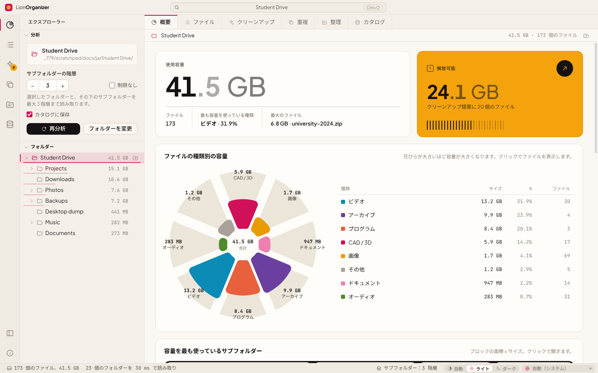
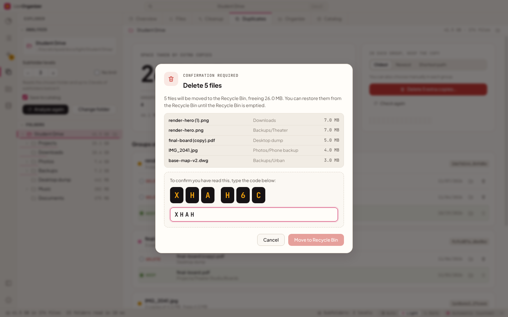
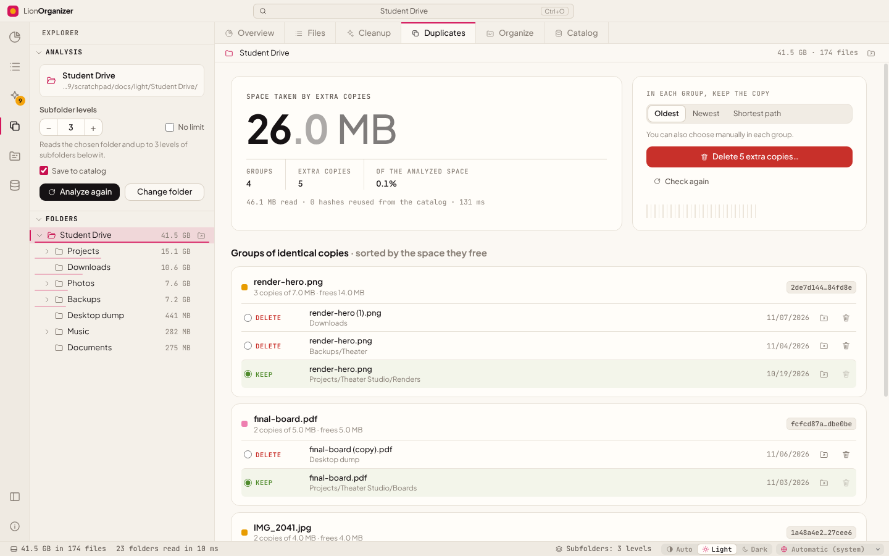
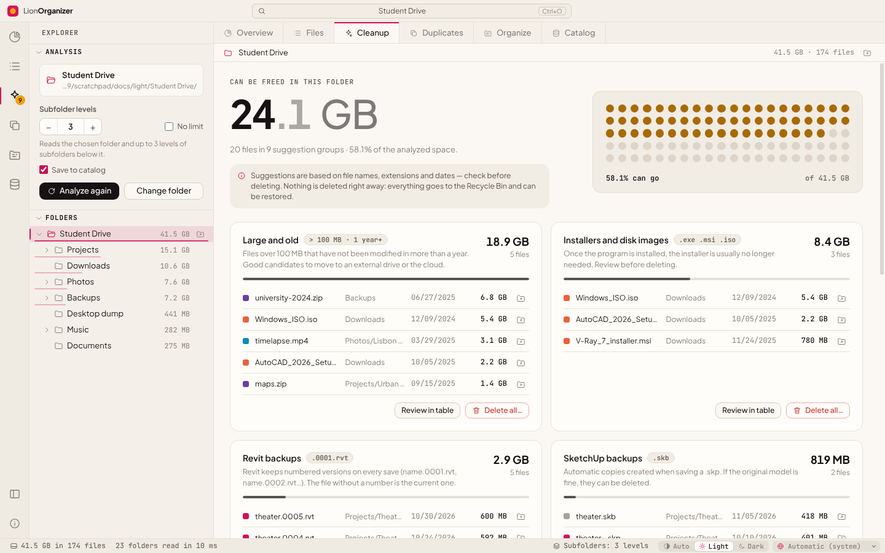
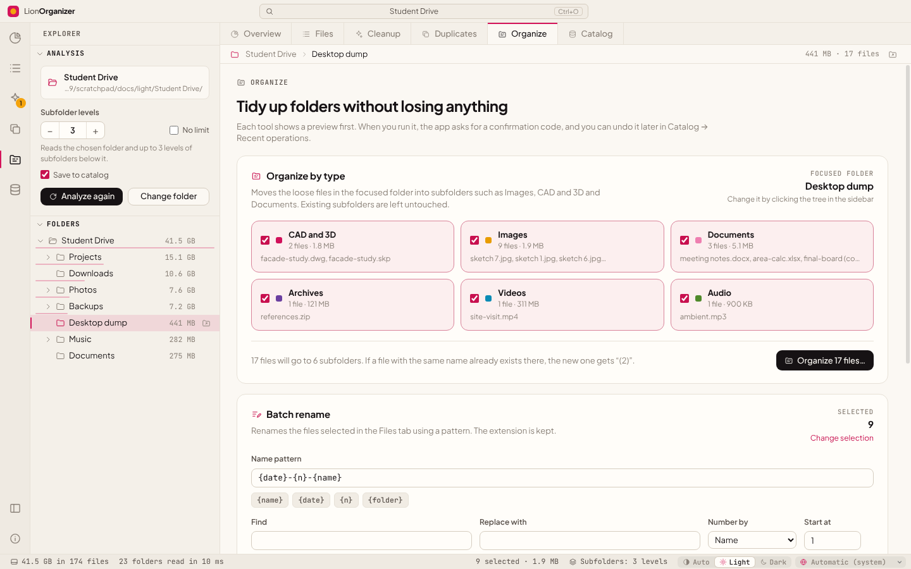
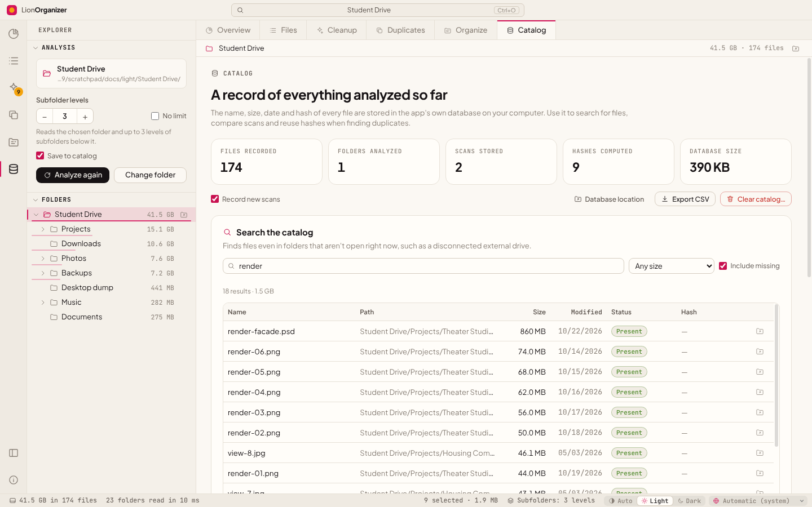
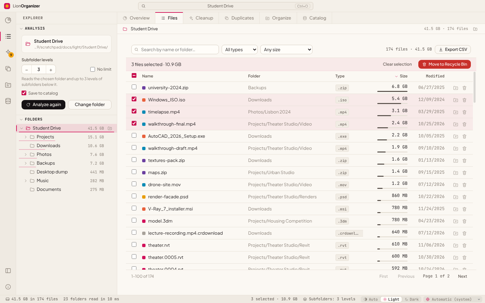
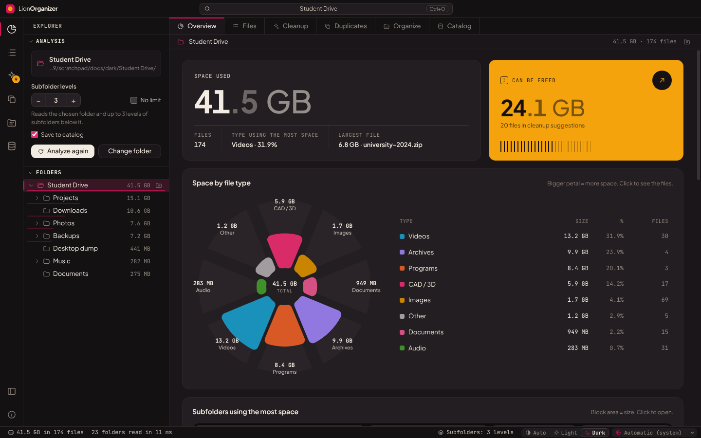
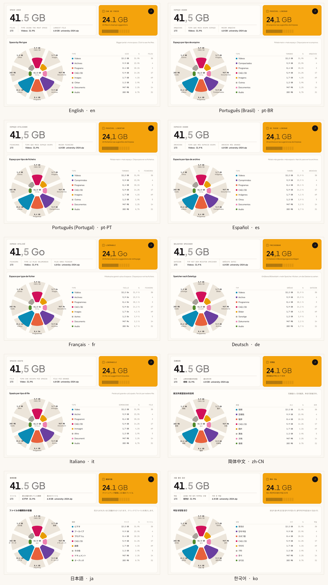

<div align="center">


# LionOrganizer

**Windows・macOS・Linux 向けのディスク容量の分析とクリーンアップ。**<br>
フォルダーの容量を何が使っているかを確認し、内容に基づいて本当の重複ファイルを見つけ、不要になったものを安全に片付けて空き容量を増やせます。

<sub>開発：<b>LionOrganizer Team</b> · 制作・考案：<b>Daniel Michelon De Carli</b></sub>

[English](../README.md) · [Português (Brasil)](README.pt-BR.md) · [Português (Portugal)](README.pt-PT.md) · [Español](README.es.md) · [Français](README.fr.md) · [Deutsch](README.de.md) · [Italiano](README.it.md) · [简体中文](README.zh-CN.md) · **日本語** · [한국어](README.ko.md)




</div>

## LionOrganizer を選ぶ理由

ディスク分析ツールは、*何が*大きいかを教えてくれます。LionOrganizer はさらに、*何を消してよいか*の判断を手助けし、誤って何かが削除されることがないようにします。きっかけはとても具体的な問題でした。建築やデザインのプロジェクトでは、CAD のバックアップ（`.skb`、`.0001.rvt`、`.bak`）、レンダリング画像、動画、コピーのコピーがたまり続け、やがてディスクがいっぱいになってしまうのです。

すべての処理は**ローカル**で行われます。アカウント、テレメトリ、ネットワーク接続は一切ありません。

## ダウンロード

お使いのシステム用のインストーラーをダウンロードしてください。どれも GitHub から**最新バージョン**を取得し、すべてのファイルを検証します（SHA-256 と署名付きビルド来歴）。

<p align="center">
  <a href="https://github.com/danielcarli/lionorganizer/releases/latest/download/LionOrganizer-Setup.exe"></a>
  <a href="https://github.com/danielcarli/lionorganizer/releases/latest/download/LionOrganizer-mac-universal.dmg"></a>
  <a href="https://github.com/danielcarli/lionorganizer/releases/latest/download/lionorganizer_amd64.deb"></a>
  <a href="https://github.com/danielcarli/lionorganizer/releases/latest/download/lionorganizer.x86_64.rpm"></a>
  <a href="https://github.com/danielcarli/lionorganizer/releases/latest/download/LionOrganizer-x86_64.AppImage"></a>
</p>

- **Windows 10/11**（x64、ARM）：約 2 MB のセットアップ ウィザード。インストール中にアプリをダウンロードして検証します。
- **macOS 11+**（Apple Silicon、Intel）：`.dmg` を開き、LionOrganizer を「アプリケーション」へドラッグします。
- **Linux**（x64）：Ubuntu、Debian、Mint… は `.deb`、Fedora、RHEL、openSUSE… は `.rpm`、またはインストール不要でどのディストリビューションでも動く AppImage。

> インストーラーはまだ有料証明書で署名されていません。初回起動時、Windows では「Windows によって PC が保護されました」と表示されることがあります（**詳細情報 › 実行**）。macOS では **システム設定 › プライバシーとセキュリティ › このまま開く** で許可してください。

**ターミナル派の方は** Windows（PowerShell、管理者権限は不要）：

```powershell
irm https://github.com/danielcarli/lionorganizer/releases/latest/download/install.ps1 | iex
```

macOS と Linux：

```bash
curl -fsSL https://github.com/danielcarli/lionorganizer/releases/latest/download/install.sh | bash
```

[すべてのバージョン](https://github.com/danielcarli/lionorganizer/releases) · [インストール ガイド](INSTALL.md)（英語）：詳細、セキュリティ、更新とアンインストール。

## 機能

| | |
|---|---|
| **分析** | フォルダーとそのサブフォルダーをスキャンします。既定では 3 階層までで、最大 50 階層または無制限に設定できます。サイズ付きのフォルダーツリー、パンくずリスト、全ファイルを並べ替え・絞り込みできる表を備えています。 |
| **可視化** | ファイルの種類別の容量（ローズチャート）、最も大きいサブフォルダー（ツリーマップ）、1 つの点が容量の 1% を表す 100 点のマトリックス、容量を最も使っている拡張子、ファイルの古さを表示します。 |
| **クリーンアップ** | 理由ごとにまとめた提案：SketchUp/Revit/AutoCAD のバックアップ、一時ファイル、ログ、未完了のダウンロード、インストーラー、大きくて古いファイル。 |
| **本当の重複** | SHA-256 で内容を比較し、必要な場合にだけ読み取ります（サイズ → 先頭と末尾の 64 KB → ファイル全体）。残すコピーを選べるほか、同じファイルがカタログ内の別のフォルダー（バックアップ用ドライブなど）にも存在するかどうかも確認できます。 |
| **整理** | 直下にあるファイルを種類別のサブフォルダーに移動したり、`{date}-{n}-{name}` のようなパターンで一括名前変更したりできます。必ずプレビューが表示され、元に戻すこともできます。 |
| **カタログと履歴** | 名前、サイズ、日付、ハッシュを保存するローカルの SQLite カタログです。これまでに分析したすべてのフォルダーを（接続されていないドライブも含めて）検索でき、スキャンを比較して新規、削除、増加した項目を確認できます。 |
| **10 言語** | English、Português (Brasil)、Português (Portugal)、Español、Français、Deutsch、Italiano、简体中文、日本語、한국어。システムから自動検出され、ステータスバーで切り替えられます。 |
| **ライトとダーク** | 自動または手動のテーマ。配色は色覚多様性に配慮して検証済みです。 |

## 安全性を最優先に

間違ったファイルを削除するのは、ディスクがいっぱいになるよりも困ります。そのため LionOrganizer は意図的に慎重な設計になっています。

- **確認コードの手入力。** ファイルを変更するすべての操作（1 個でも複数でも*あらゆる*削除、整理、名前の変更、元に戻す操作、カタログの消去）では 6 文字のコードが表示され、それを**入力**しないとボタンが有効になりません（貼り付けはできません）。コードはメインプロセスで生成・検証されるため、画面側で省略することはできません。5 回間違えると操作はキャンセルされます。
- **完全削除ではなく、ごみ箱へ。** 削除したファイルは Windows のごみ箱に移動されます。
- **対象を限定した操作。** メインプロセスが扱うのは、分析したフォルダーに含まれ、前回のスキャンで確認されたファイルだけです。
- **元に戻す。** 整理と名前の変更の操作は記録され、*カタログ → 最近の操作* から元に戻せます。
- **既定では読み取り専用。** 分析と重複の確認では、何も変更されません。

<div align="center">

</div>

## スクリーンショット

| | |
|---|---|
|  **重複** — SHA-256 でグループ化された同一のコピー |  **クリーンアップ** — 理由ごとにまとめた提案 |
|  **整理** — 種類別の整理と一括名前変更（プレビュー付き） |  **カタログ** — 検索、履歴、元に戻す |
|  **ファイル** — すべてのファイルを並べ替え・絞り込み |  **ダークテーマ** |

冒頭の画像以外のスクリーンショットは、英語のインターフェイスを表示しています。

<div align="center">

<br><sub>同じ画面を、サポートされている 10 言語で表示したもの。</sub>
</div>

## はじめに

### ソースから実行する（Windows）

1. [Node.js LTS](https://nodejs.org) をインストールします。
2. このリポジトリをダウンロードまたはクローンします。
3. **`start.bat`** をダブルクリックします。初回実行時に依存関係がインストールされます。

ターミナルから実行する場合：

```powershell
npm install
npm start
```

> PowerShell でスクリプトの実行が無効になっている場合は、`npm` の代わりに `npm.cmd` を使用してください。

### インストーラーを作成する

**`build-installer.bat`** をダブルクリックします（または `npm run dist` を実行します）。`dist/` にインストーラーとポータブル版の `.exe` が作成されます。

## キーボードショートカット

| ショートカット | 操作 |
|---|---|
| `Ctrl+O` | フォルダーを開く |
| `F5` | 再分析 |
| `Ctrl+1` … `Ctrl+6` | 概要 · ファイル · クリーンアップ · 重複 · 整理 · カタログ |
| `Ctrl+B` | サイドバーの表示/非表示 |
| `Esc` | 実行中の分析または重複の確認をキャンセル |

## 言語

| 言語 | コード | | 言語 | コード |
|---|---|---|---|---|
| English | `en` | | Deutsch | `de` |
| Português (Brasil) | `pt-BR` | | Italiano | `it` |
| Português (Portugal) | `pt-PT` | | 简体中文 | `zh-CN` |
| Español | `es` | | 日本語 | `ja` |
| Français | `fr` | | 한국어 | `ko` |

言語は既定で Windows の設定に従い、ステータスバーで変更できます。数値、日付、サイズの単位は選択した言語に合わせて表示されます（たとえばフランス語では *Mo* や *Go* と表示されます）。翻訳がない箇所は英語で表示されます。

言語を追加したり、翻訳を改善したりしたい場合は、[CONTRIBUTING.md](../CONTRIBUTING.md#translations) をご覧ください。JSON ファイルを 1 つ用意するだけです。

## プライバシー

LionOrganizer はオフラインで動作します。カタログは、お使いのコンピューター上の 1 つのファイルです。

```
%APPDATA%\LionOrganizer\catalog.sqlite
```

記録はいつでもオフにでき（サイドバーの「カタログに保存」）、*カタログ*ビューから CSV にエクスポートしたり消去したりできます。カタログを消去しても、ファイルが削除されることはありません。

## アーキテクチャ

コードは [Visual Studio Code](https://github.com/microsoft/vscode) のレイヤー構成に従っています。`base` は上位のレイヤーに依存せず、`platform` がシステムサービスを提供し、`workbench` がインターフェイスを構築します。メインプロセス（Node.js）とインターフェイス（Node にアクセスできないサンドボックス化されたレンダラー）は、`preload` ブリッジを介してのみ通信します。

```
src/
  base/
    common/              pure utilities: events, formatting, i18n (nls.js)
    browser/             DOM helpers, icons, charts (rose, treemap, dot matrix, bars, hatched columns)
  platform/              main-process services
    files/               folder scanner with depth limit
    catalog/             SQLite catalog, history, operation log, duplicate finder (SHA-256)
    operations/          file-changing operations guarded by the typed confirmation code
    shell/ · dialogs/    Explorer integration, native dialogs
    nls/                 i18n for the main process
  code/
    electron-main/       entry point: window, app:// protocol, service wiring
    electron-sandbox/    preload bridge
  nls/                   message catalogs: en.json, pt-BR.json, … (one file per language)
  workbench/
    browser/             bootstrap, layout parts (title bar, activity bar, side bar, editor, status bar), styles
    services/            analysis model, scan, layout, notifications, operations, confirmation, duplicates, catalog
    contrib/             views: overview, files, cleanup, duplicates, organize, catalog
```

セキュリティ：`contextIsolation` と `sandbox` を有効にし、`nodeIntegration` は使用せず、厳格なコンテンツセキュリティポリシーを適用しています。また、ファイルを変更するすべての要求はメインプロセスで検証されます。

## 開発

| コマンド | 内容 |
|---|---|
| `npm start` | アプリを実行 |
| `npm run dist` | Windows 用インストーラーとポータブル版アプリを作成 |
| `npm run test:e2e` | エンドツーエンドテスト：**使い捨て**のフォルダーを分析し、重複、削除、整理、名前の変更、元に戻す操作、カタログを実行して、ディスク上の結果を確認します |
| `npm run docs:screenshots` | `docs/screenshots` のスクリーンショットを再生成 |

```powershell
# the end-to-end test changes files: always point it to a throwaway folder
$env:E2E_FOLDER="C:\temp\lion-test"; $env:E2E_OUT="C:\temp\lion-out"; npm run test:e2e
```

## コントリビューション

バグ報告、アイデア、プルリクエストを歓迎します。特に翻訳は大歓迎です。[CONTRIBUTING.md](../CONTRIBUTING.md) をお読みください。

## クレジット

LionOrganizer は、建築・都市計画を学ぶ学生である **Daniel Michelon De Carli が制作・考案**し、**LionOrganizer Team** がコントリビューターや翻訳者とともにメンテナンスしています。

同梱フォント：[Plus Jakarta Sans](https://github.com/tokotype/PlusJakartaSans) と [JetBrains Mono](https://github.com/JetBrains/JetBrainsMono)（SIL Open Font License）。アーキテクチャは [Visual Studio Code](https://github.com/microsoft/vscode) から着想を得ています。

## ライセンス

Copyright © 2026 LionOrganizer Team.

LionOrganizer はフリーソフトウェアです。Free Software Foundation が公表した **[GNU General Public License v3.0](../LICENSE)** のバージョン 3、または（お好みで）それ以降のバージョンの条件に従って、再頒布や改変を行うことができます。LionOrganizer は有用であることを願って頒布されますが、**いかなる保証もありません**。詳しくはライセンスをご覧ください。

要するに、LionOrganizer は自由に使用、研究、共有、改変できます。改変したバージョンを頒布する場合は、それも GPL のもとでソースコードとともに公開する必要があります。

この日本語訳は参考用であり、法的な効力を持つのは英語のライセンス文です。
