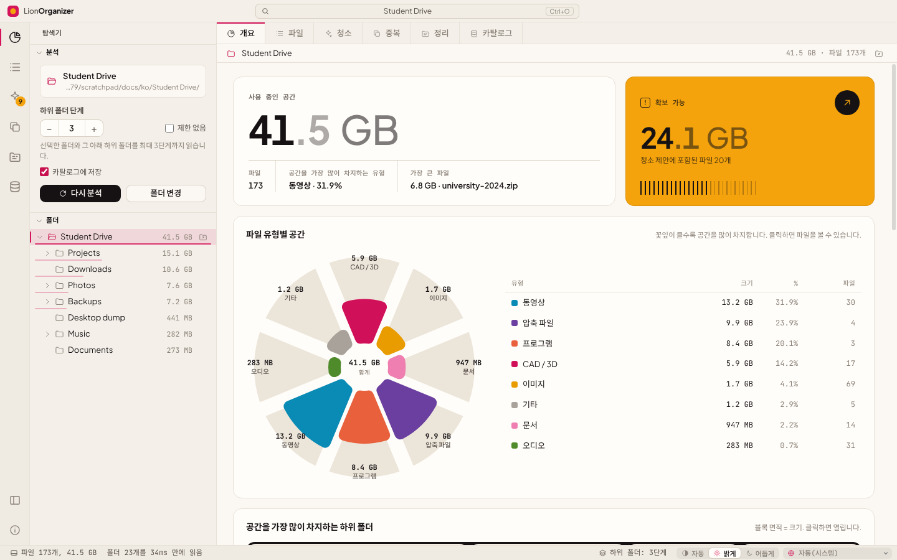

<div align="center">


# LionOrganizer

**Windows, macOS, Linux용 디스크 공간 분석 및 청소 도구.**<br>
폴더에서 무엇이 공간을 차지하는지 확인하고, 내용을 기준으로 진짜 중복 파일을 찾아 더 이상 필요 없는 항목을 안전하게 정리하세요.

<sub>개발: <b>LionOrganizer Team</b> · 제작 및 기획: <b>Daniel Michelon De Carli</b></sub>

[English](../README.md) · [Português (Brasil)](README.pt-BR.md) · [Português (Portugal)](README.pt-PT.md) · [Español](README.es.md) · [Français](README.fr.md) · [Deutsch](README.de.md) · [Italiano](README.it.md) · [简体中文](README.zh-CN.md) · [日本語](README.ja.md) · **한국어**


<p>
  <a href="https://github.com/danielcarli/lionorganizer/releases/latest/download/LionOrganizer-Setup.exe"></a>
  <a href="https://github.com/danielcarli/lionorganizer/releases/latest/download/LionOrganizer-mac-universal.dmg"></a>
  <a href="https://github.com/danielcarli/lionorganizer/releases/latest/download/lionorganizer_amd64.deb"></a>
  <a href="https://github.com/danielcarli/lionorganizer/releases/latest/download/lionorganizer.x86_64.rpm"></a>
  <a href="https://github.com/danielcarli/lionorganizer/releases/latest/download/LionOrganizer-x86_64.AppImage"></a>
</p>

<sub><a href="https://github.com/danielcarli/lionorganizer/releases">모든 버전</a> · <a href="#다운로드">설치 방법</a></sub>



</div>

## 왜 LionOrganizer인가요?

디스크 분석 도구는 *무엇이* 큰지 알려 줍니다. LionOrganizer는 여기서 더 나아가 *무엇을 지워도 되는지* 판단하도록 돕고, 실수로 삭제되는 일이 없도록 합니다. 이 앱은 아주 구체적인 문제에서 시작되었습니다. 건축과 디자인 프로젝트에서는 CAD 백업(`.skb`, `.0001.rvt`, `.bak`), 렌더링 이미지, 동영상, 사본의 사본이 계속 쌓여 결국 디스크가 가득 차게 됩니다.

모든 작업은 **로컬**에서 실행됩니다. 계정과 원격 분석이 없으며, 유일한 연결은 끌 수 있는 새 버전 확인입니다.

**LionOrganizer만의 차별점**

- **측정만 하지 않고 결정을 돕습니다** — 이유별로 묶은 정리 제안. 건축 프로젝트에 쌓이는 CAD/BIM 백업(SketchUp `.skb`, Revit `.0001.rvt`, AutoCAD `.bak`)도 포함합니다.
- **실수로 삭제되는 일이 없습니다** — 삭제할 때마다 앱이 직접 검증하는 확인 코드를 입력해야 하며, 파일은 휴지통으로 이동합니다.
- **내용 기준의 진짜 중복** — SHA-256으로 확인하며, 남길 사본은 사용자가 고릅니다.
- **분석 간의 기록** — 로컬 카탈로그로 분석한 모든 폴더(연결이 끊긴 드라이브 포함)를 검색하고, 새로 생긴 것·삭제된 것·커진 것을 볼 수 있습니다.
- **정리와 이름 바꾸기, 실행 취소 가능** — 흩어진 파일을 유형별 폴더로 정리하고 패턴으로 일괄 이름 바꾸기. 항상 미리보기를 제공합니다.
- **AI의 두 번째 의견** — 사용자의 언어로 보고서를 내보내 AI가 가장 안전하게 삭제할 수 있을 것 같은 항목을 알려 주게 합니다. 앱은 아무것도 보내지 않습니다. 그런 다음 답변을 다시 붙여 넣으면, 언급된 파일이 AI가 매긴 위험도와 함께 표시되어 바로 검토할 수 있습니다.
- **파일이 사라지면 알아챕니다** — 앱 밖에서 삭제되거나 이동된 파일은 회색으로 표시되며, 목록에서 제거할 수 있습니다.
- **모두를 위해** — 10개 언어, 밝은/어두운 테마, 그리고 Windows·macOS·Linux용 검증된 설치 프로그램.

## 다운로드

사용 중인 시스템용 설치 프로그램을 내려받으세요. 모든 설치 프로그램은 GitHub에서 **최신 버전**을 가져오며 모든 파일을 검증합니다(SHA-256 및 서명된 빌드 출처).

- **Windows 10/11** (x64, ARM): 약 2MB 설치 마법사로, 설치 중에 앱을 내려받아 검증합니다. → [`LionOrganizer-Setup.exe`](https://github.com/danielcarli/lionorganizer/releases/latest/download/LionOrganizer-Setup.exe)
- **macOS 11+** (Apple Silicon, Intel): `.dmg`를 열고 LionOrganizer를 응용 프로그램으로 드래그하세요. → [`LionOrganizer-mac-universal.dmg`](https://github.com/danielcarli/lionorganizer/releases/latest/download/LionOrganizer-mac-universal.dmg)
- **Linux** (x64): Ubuntu, Debian, Mint…는 `.deb`, Fedora, RHEL, openSUSE…는 `.rpm`, 또는 설치 없이 모든 배포판에서 실행되는 AppImage. → [`.deb`](https://github.com/danielcarli/lionorganizer/releases/latest/download/lionorganizer_amd64.deb) · [`.rpm`](https://github.com/danielcarli/lionorganizer/releases/latest/download/lionorganizer.x86_64.rpm) · [AppImage](https://github.com/danielcarli/lionorganizer/releases/latest/download/LionOrganizer-x86_64.AppImage)

> 설치 프로그램은 아직 유료 인증서로 서명되지 않았습니다. 처음 실행할 때 Windows에서 "Windows의 PC 보호" 창이 나타날 수 있으며(**추가 정보 › 실행**), macOS에서는 **시스템 설정 › 개인정보 보호 및 보안 › 그래도 열기**에서 앱을 허용해야 합니다.

**터미널이 더 편하신가요?** Windows(PowerShell, 관리자 권한 불필요):

```powershell
irm https://github.com/danielcarli/lionorganizer/releases/latest/download/install.ps1 | iex
```

macOS 및 Linux:

```bash
curl -fsSL https://github.com/danielcarli/lionorganizer/releases/latest/download/install.sh | bash
```

[모든 버전](https://github.com/danielcarli/lionorganizer/releases) · [설치 가이드](INSTALL.md)(영어): 자세한 내용, 보안, 업데이트 및 제거.

## 기능

| | |
|---|---|
| **분석** | 폴더와 하위 폴더를 스캔합니다. 기본값은 3단계이며, 최대 50단계 또는 무제한으로 설정할 수 있습니다. 크기가 표시되는 폴더 트리, 이동 경로, 모든 파일을 정렬하고 필터링할 수 있는 표를 제공합니다. |
| **큰 폴더** | 마지막 분석이 카탈로그에서 날짜와 함께 바로 다시 열리며, 폴더는 요청할 때만 백그라운드에서 다시 분석합니다. 분석한 공간과 디스크 사용 공간을 나란히 보여 주고 차이의 이유(읽지 못한 항목, 단계 제한, 시스템 파일)도 알려 줍니다. 제외할 폴더 목록(`node_modules`, `.git`, 시스템 폴더)은 선택 사항이며 기본값은 꺼짐입니다. 시스템이 읽기를 허용하지 않은 항목은 이유와 함께 표시되고, Windows에서는 관리자 권한으로 다시 분석할 수 있습니다. |
| **시각화** | 파일 유형별 공간(로즈 차트), 가장 큰 하위 폴더(트리맵), 점 하나가 공간의 1%를 나타내는 100개 점 매트릭스, 공간을 가장 많이 차지하는 확장자, 파일 경과 기간을 보여 줍니다. |
| **공간 지도** | 전체 화면 트리맵: 각 파일은 폴더 안에 중첩된 블록이며 유형별로 색이 다릅니다. 블록을 클릭하면 그 폴더로 들어가고, Backspace나 오른쪽 클릭으로 위로 갑니다. |
| **청소** | 이유별로 묶은 제안: SketchUp/Revit/AutoCAD 백업, 임시 파일, 로그, 완료되지 않은 다운로드, 설치 파일, 크고 오래된 파일. |
| **더 많은 정리 대상** | 렌더링 및 CAD 캐시(Twinmotion, Lumion, Enscape, V-Ray, Corona, Revit 저널, Adobe 미디어 캐시), 빈 파일과 빈 폴더 — 폴더도 확인 코드를 입력해야만 휴지통으로 이동합니다. |
| **진짜 중복** | SHA-256으로 내용을 비교하며, 필요할 때만 읽습니다(크기 → 처음/끝 64 KB → 파일 전체). 남길 사본을 선택할 수 있고, 같은 파일이 카탈로그에 등록된 다른 폴더(예: 백업 드라이브)에도 있는지 확인할 수 있습니다. |
| **정리** | 폴더에 바로 들어 있는 파일을 유형별 하위 폴더로 옮기고, `{date}-{n}-{name}` 같은 패턴으로 일괄 이름 바꾸기를 할 수 있습니다. 항상 미리 보기가 제공되며 실행 취소할 수 있습니다. |
| **카탈로그 및 기록** | 이름, 크기, 날짜, 해시를 저장하는 로컬 SQLite 카탈로그입니다. 연결이 끊긴 드라이브를 포함해 지금까지 분석한 모든 폴더에서 검색할 수 있고, 스캔을 비교해 새로 생기거나 제거되거나 커지는 항목을 확인할 수 있습니다. |
| **10개 언어** | English, Português (Brasil), Português (Portugal), Español, Français, Deutsch, Italiano, 简体中文, 日本語, 한국어 — 시스템에서 자동으로 감지되며 상태 표시줄에서 바꿀 수 있습니다. |
| **밝게 및 어둡게** | 자동 또는 수동 테마를 지원하며, 색각 이상을 고려해 검증한 색상 팔레트를 사용합니다. |

## 안전 최우선

잘못된 파일을 삭제하는 것은 디스크가 가득 차는 것보다 나쁩니다. 그래서 LionOrganizer는 일부러 신중하게 설계되었습니다.

- **확인 코드 직접 입력.** 파일을 변경하는 모든 작업(파일 하나든 여러 개든 *모든* 삭제, 정리, 이름 바꾸기, 실행 취소, 카탈로그 지우기)에서는 6자리 코드가 표시되며, 이 코드를 **직접 입력**해야(붙여넣기 불가) 버튼이 활성화됩니다. 코드는 메인 프로세스에서 생성하고 검증하므로 인터페이스에서 건너뛸 수 없습니다. 다섯 번 틀리면 작업이 취소됩니다.
- **영구 삭제가 아닌 휴지통.** 삭제한 파일은 Windows 휴지통으로 이동됩니다.
- **범위가 제한된 작업.** 메인 프로세스는 분석한 폴더에 속하고 마지막 스캔에서 확인된 파일만 다룹니다.
- **실행 취소.** 정리와 이름 바꾸기 작업은 기록되며 *카탈로그 → 최근 작업*에서 되돌릴 수 있습니다.
- **기본적으로 읽기 전용.** 분석과 중복 확인은 아무것도 수정하지 않습니다.

<div align="center">

</div>

## 스크린샷

| | |
|---|---|
|  **중복** — SHA-256으로 묶은 동일한 사본 |  **청소** — 이유별로 묶은 제안 |
|  **정리** — 유형별 정리 및 일괄 이름 바꾸기, 미리 보기 제공 |  **카탈로그** — 검색, 기록, 실행 취소 |
|  **파일** — 모든 파일을 정렬하고 필터링 |  **어두운 테마** |

맨 위의 이미지를 제외한 나머지 스크린샷은 영어 인터페이스를 보여 줍니다.

<div align="center">

<br><sub>지원되는 10개 언어로 표시한 같은 화면입니다.</sub>
</div>

## 시작하기

### 소스에서 실행(Windows)

1. [Node.js LTS](https://nodejs.org)를 설치합니다.
2. 이 저장소를 다운로드하거나 복제합니다.
3. **`start.bat`** 파일을 두 번 클릭합니다. 처음 실행할 때 종속성이 설치됩니다.

또는 터미널에서 실행합니다.

```powershell
npm install
npm start
```

> PowerShell에서 스크립트 실행이 비활성화되어 있다면 `npm` 대신 `npm.cmd`를 사용하세요.

### 설치 프로그램 만들기

**`build-installer.bat`** 파일을 두 번 클릭합니다(또는 `npm run dist` 실행). `dist/`에 설치 프로그램과 포터블 `.exe`가 만들어집니다.

## 바로 가기 키

| 바로 가기 키 | 작업 |
|---|---|
| `Ctrl+O` | 폴더 열기 |
| `F5` | 다시 분석 |
| `Ctrl+1` … `Ctrl+7` | 개요 · 파일 · 청소 · 중복 · 정리 · 카탈로그 · 공간 지도 |
| `Ctrl+B` | 사이드바 표시/숨기기 |
| `Esc` | 진행 중인 분석 또는 중복 확인 취소 |

## 언어

| 언어 | 코드 | | 언어 | 코드 |
|---|---|---|---|---|
| English | `en` | | Deutsch | `de` |
| Português (Brasil) | `pt-BR` | | Italiano | `it` |
| Português (Portugal) | `pt-PT` | | 简体中文 | `zh-CN` |
| Español | `es` | | 日本語 | `ja` |
| Français | `fr` | | 한국어 | `ko` |

언어는 기본적으로 Windows 설정을 따르며 상태 표시줄에서 바꿀 수 있습니다. 숫자, 날짜, 크기 단위는 선택한 언어의 형식을 따릅니다(예: 프랑스어에서는 *Mo*, *Go*로 표시). 번역이 없는 문구는 영어로 표시됩니다.

언어를 추가하거나 번역을 개선하고 싶으신가요? [CONTRIBUTING.md](../CONTRIBUTING.md#translations)를 참고하세요. JSON 파일 하나만 있으면 됩니다.

## 개인정보 보호

LionOrganizer는 오프라인으로 작동합니다. 유일한 연결은 새 버전 확인으로, GitHub에 게시된 프로젝트 버전에서 작은 파일 하나만 읽으며 사용자나 파일에 관한 데이터는 보내지 않습니다. 오른쪽 아래의 버전 번호를 클릭하면 끌 수 있습니다. "AI용으로 내보내기" 보고서는 앱이 어디에도 보내지 않으며, 붙여 넣을 곳은 사용자가 정합니다.

카탈로그는 컴퓨터에 있는 파일 하나입니다.

```
%APPDATA%\LionOrganizer\catalog.sqlite
```

언제든지 기록을 끄거나(사이드바의 ‘카탈로그에 저장’), *카탈로그* 보기에서 CSV로 내보내거나 지울 수 있습니다. 카탈로그를 지워도 파일은 절대 삭제되지 않습니다.

## 아키텍처

코드는 [Visual Studio Code](https://github.com/microsoft/vscode)의 계층 구조를 따릅니다. `base`는 상위 계층을 전혀 알지 못하고, `platform`은 시스템 서비스를 제공하며, `workbench`는 인터페이스를 구성합니다. 메인 프로세스(Node.js)와 인터페이스(Node에 접근할 수 없는 샌드박스 렌더러)는 `preload` 브리지를 통해서만 통신합니다.

```
src/
  base/
    common/              pure utilities: events, formatting, i18n (nls.js)
    browser/             DOM helpers, icons, charts (rose, treemap, dot matrix, bars, hatched columns)
  platform/              main-process services
    files/               folder scanner with depth limit
    catalog/             SQLite catalog, history, operation log, duplicate finder (SHA-256)
    operations/          file-changing operations guarded by the typed confirmation code
    shell/ · dialogs/    Explorer integration, native dialogs
    nls/                 i18n for the main process
  code/
    electron-main/       entry point: window, app:// protocol, service wiring
    electron-sandbox/    preload bridge
  nls/                   message catalogs: en.json, pt-BR.json, … (one file per language)
  workbench/
    browser/             bootstrap, layout parts (title bar, activity bar, side bar, editor, status bar), styles
    services/            analysis model, scan, layout, notifications, operations, confirmation, duplicates, catalog
    contrib/             views: overview, files, cleanup, duplicates, organize, catalog
```

보안: `contextIsolation`과 `sandbox`를 켜고, `nodeIntegration`은 사용하지 않으며, 엄격한 콘텐츠 보안 정책을 적용합니다. 또한 파일을 변경하는 모든 요청은 메인 프로세스에서 검증합니다.

## 개발

| 명령 | 설명 |
|---|---|
| `npm start` | 앱 실행 |
| `npm run dist` | Windows 설치 프로그램과 포터블 앱 빌드 |
| `npm run test:e2e` | 엔드투엔드 테스트: **일회용** 폴더를 분석하고 중복, 삭제, 정리, 이름 바꾸기, 실행 취소, 카탈로그를 실행한 뒤 디스크에서 결과를 확인합니다 |
| `npm run docs:screenshots` | `docs/screenshots`의 스크린샷 다시 생성 |

```powershell
# the end-to-end test changes files: always point it to a throwaway folder
$env:E2E_FOLDER="C:\temp\lion-test"; $env:E2E_OUT="C:\temp\lion-out"; npm run test:e2e
```

## 기여하기

버그 보고, 아이디어, 풀 리퀘스트를 환영합니다. 특히 번역을 환영합니다. [CONTRIBUTING.md](../CONTRIBUTING.md)를 읽어 주세요.

## 크레딧

LionOrganizer는 건축 및 도시계획을 공부하는 학생인 **Daniel Michelon De Carli가 제작하고 기획**했으며, **LionOrganizer Team**이 기여자 및 번역자와 함께 유지 관리하고 있습니다.

포함된 글꼴: [Plus Jakarta Sans](https://github.com/tokotype/PlusJakartaSans) 및 [JetBrains Mono](https://github.com/JetBrains/JetBrainsMono), SIL Open Font License. 아키텍처는 [Visual Studio Code](https://github.com/microsoft/vscode)에서 영감을 받았습니다.

## 라이선스

Copyright © 2026 LionOrganizer Team.

LionOrganizer는 자유 소프트웨어입니다. 자유 소프트웨어 재단(Free Software Foundation)이 공표한 **[GNU General Public License v3.0](../LICENSE)** 버전 3 또는 (선택에 따라) 그 이후 버전의 조건에 따라 재배포하거나 수정할 수 있습니다. 이 프로그램은 유용하게 쓰이기를 바라며 배포되지만, **어떠한 보증도 제공하지 않습니다**. 자세한 내용은 라이선스를 참고하세요.

요약하면, LionOrganizer는 자유롭게 사용, 연구, 공유, 수정할 수 있습니다. 수정한 버전을 배포하는 경우 그 버전도 소스 코드와 함께 GPL로 공개해야 합니다.

이 한국어 번역은 참고용이며, 법적 효력이 있는 것은 영어 라이선스 원문입니다.
