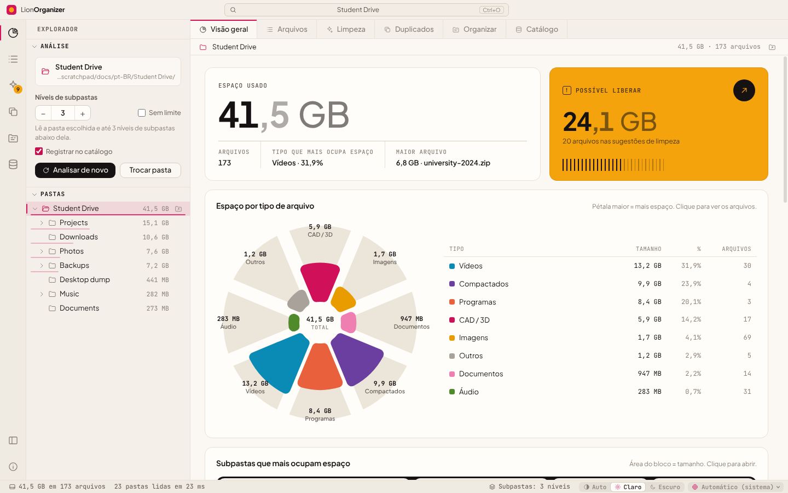

<div align="center">


# LionOrganizer

**Análise e limpeza de espaço em disco para Windows.**<br>
Veja o que ocupa espaço nas suas pastas, encontre duplicados de verdade pelo conteúdo e libere com segurança o que você não usa mais.

<sub>pelo <b>LionOrganizer Team</b> · criado e idealizado por <b>Daniel Michelon De Carli</b></sub>

[English](../README.md) · **Português (Brasil)** · [Português (Portugal)](README.pt-PT.md) · [Español](README.es.md) · [Français](README.fr.md) · [Deutsch](README.de.md) · [Italiano](README.it.md) · [简体中文](README.zh-CN.md) · [日本語](README.ja.md) · [한국어](README.ko.md)




</div>

## Por que o LionOrganizer?

Analisadores de disco mostram *o que* é grande. O LionOrganizer também ajuda a decidir *o que pode sair* — e garante que nada seja excluído por engano. Ele nasceu de um problema bem concreto: projetos de arquitetura e design acumulam backups de CAD (`.skb`, `.0001.rvt`, `.bak`), renders, vídeos e cópias de cópias até o disco encher.

Tudo roda **localmente**. Não há conta, nem telemetria, nem acesso à rede.

## Recursos

| | |
|---|---|
| **Analisar** | Varre uma pasta e suas subpastas — 3 níveis de profundidade por padrão, configurável até 50 níveis ou sem limite. Árvore de pastas com tamanhos, trilha de navegação e uma tabela de todos os arquivos, com ordenação e filtros. |
| **Visualizar** | Espaço por tipo de arquivo (gráfico de rosa), maiores subpastas (treemap), uma matriz de 100 pontos em que cada ponto é 1 % do espaço, as extensões que mais ocupam e a idade dos arquivos. |
| **Limpar** | Sugestões agrupadas por motivo: backups do SketchUp/Revit/AutoCAD, arquivos temporários, logs, downloads incompletos, instaladores, arquivos grandes e antigos. |
| **Duplicados de verdade** | Comparação de conteúdo com SHA-256, lendo só o necessário (tamanho → primeiros/últimos 64 KB → arquivo inteiro). Escolha qual cópia manter; veja quando o mesmo arquivo também existe em outra pasta catalogada (por exemplo, um HD de backup). |
| **Organizar** | Mova arquivos soltos para subpastas por tipo e renomeie em lote com padrões como `{date}-{n}-{name}`. Sempre com prévia, e tudo pode ser desfeito. |
| **Catálogo e histórico** | Um catálogo SQLite local com nomes, tamanhos, datas e hashes. Procure em todas as pastas que você já analisou — até em unidades desconectadas — e compare análises para ver o que é novo, o que foi removido ou o que está crescendo. |
| **10 idiomas** | English, Português (Brasil), Português (Portugal), Español, Français, Deutsch, Italiano, 简体中文, 日本語, 한국어 — detectado pelo sistema e alternável na barra de status. |
| **Claro e escuro** | Tema automático ou manual, com uma paleta de cores verificada para deficiências de visão de cores. |

## Segurança em primeiro lugar

Excluir o arquivo errado é pior do que um disco cheio, por isso o LionOrganizer é cuidadoso de propósito:

- **Código de confirmação digitado.** Toda ação que altera arquivos — *qualquer* exclusão (de um arquivo ou de vários), organizar, renomear, desfazer e limpar o catálogo — mostra um código de 6 caracteres que precisa ser **digitado** (colar está desativado) antes de o botão ser liberado. O código é gerado e verificado pelo processo principal, então a interface não consegue pulá-lo. Cinco tentativas erradas cancelam a operação.
- **Lixeira, não exclusão permanente.** Os arquivos excluídos vão para a Lixeira do Windows.
- **Ações restritas.** O processo principal só mexe em arquivos que pertencem à pasta analisada e que apareceram na última análise.
- **Desfazer.** As operações de organizar e renomear ficam registradas e podem ser revertidas em *Catálogo → Operações recentes*.
- **Somente leitura por padrão.** Analisar e procurar duplicados nunca modificam nada.

<div align="center">

</div>

## Capturas de tela

| | |
|---|---|
|  **Duplicados** — cópias idênticas agrupadas por SHA-256 |  **Limpeza** — sugestões agrupadas por motivo |
|  **Organizar** — por tipo e renomear em lote, com prévia |  **Catálogo** — busca, histórico e desfazer |
|  **Arquivos** — todos os arquivos, com ordenação e filtros |  **Tema escuro** |

As demais capturas de tela mostram a interface em inglês.

<div align="center">

<br><sub>A mesma tela nos dez idiomas suportados.</sub>
</div>

## Primeiros passos

### Executar a partir do código-fonte (Windows)

1. Instale o [Node.js LTS](https://nodejs.org).
2. Baixe ou clone este repositório.
3. Dê um duplo clique em **`start.bat`** — na primeira execução, as dependências são instaladas.

Ou pelo terminal:

```powershell
npm install
npm start
```

> No PowerShell, se os scripts estiverem desativados, use `npm.cmd` em vez de `npm`.

### Gerar um instalador

Dê um duplo clique em **`build-installer.bat`** (ou execute `npm run dist`). Um instalador e um `.exe` portátil são criados em `dist/`.

## Atalhos de teclado

| Atalho | Ação |
|---|---|
| `Ctrl+O` | Abrir pasta |
| `F5` | Analisar de novo |
| `Ctrl+1` … `Ctrl+6` | Visão geral · Arquivos · Limpeza · Duplicados · Organizar · Catálogo |
| `Ctrl+B` | Mostrar/ocultar barra lateral |
| `Esc` | Cancelar a análise ou a verificação de duplicados em andamento |

## Idiomas

| Idioma | Código | | Idioma | Código |
|---|---|---|---|---|
| English | `en` | | Deutsch | `de` |
| Português (Brasil) | `pt-BR` | | Italiano | `it` |
| Português (Portugal) | `pt-PT` | | 简体中文 | `zh-CN` |
| Español | `es` | | 日本語 | `ja` |
| Français | `fr` | | 한국어 | `ko` |

Por padrão, o idioma segue o do Windows e pode ser trocado na barra de status. Números, datas e unidades de tamanho seguem o idioma escolhido (por exemplo, em francês aparecem *Mo* e *Go*). Traduções que faltarem são mostradas em inglês.

Quer adicionar ou melhorar um idioma? Veja o [CONTRIBUTING.md](../CONTRIBUTING.md#translations) — basta um arquivo JSON.

## Privacidade

O LionOrganizer funciona offline. O catálogo é um único arquivo no seu computador:

```
%APPDATA%\LionOrganizer\catalog.sqlite
```

Você pode desligar o registro (“Registrar no catálogo”, na barra lateral), exportá-lo para CSV ou limpá-lo na visualização *Catálogo* a qualquer momento. Limpar o catálogo nunca exclui seus arquivos.

## Arquitetura

O código segue a divisão em camadas do [Visual Studio Code](https://github.com/microsoft/vscode): `base` não conhece nada acima dela, `platform` fornece os serviços do sistema e `workbench` monta a interface. O processo principal (Node.js) e a interface (um renderer em sandbox, sem acesso ao Node) só se comunicam pela ponte `preload`.

```
src/
  base/
    common/              pure utilities: events, formatting, i18n (nls.js)
    browser/             DOM helpers, icons, charts (rose, treemap, dot matrix, bars, hatched columns)
  platform/              main-process services
    files/               folder scanner with depth limit
    catalog/             SQLite catalog, history, operation log, duplicate finder (SHA-256)
    operations/          file-changing operations guarded by the typed confirmation code
    shell/ · dialogs/    Explorer integration, native dialogs
    nls/                 i18n for the main process
  code/
    electron-main/       entry point: window, app:// protocol, service wiring
    electron-sandbox/    preload bridge
  nls/                   message catalogs: en.json, pt-BR.json, … (one file per language)
  workbench/
    browser/             bootstrap, layout parts (title bar, activity bar, side bar, editor, status bar), styles
    services/            analysis model, scan, layout, notifications, operations, confirmation, duplicates, catalog
    contrib/             views: overview, files, cleanup, duplicates, organize, catalog
```

Segurança: `contextIsolation` e `sandbox` ativados, sem `nodeIntegration`, uma Content Security Policy rigorosa, e toda solicitação que altera arquivos é validada no processo principal.

## Desenvolvimento

| Comando | O que faz |
|---|---|
| `npm start` | Executa o app |
| `npm run dist` | Gera o instalador para Windows e o app portátil |
| `npm run test:e2e` | Teste de ponta a ponta: analisa uma pasta **descartável** e exercita duplicados, exclusão, organizar, renomear, desfazer e o catálogo, conferindo os resultados no disco |
| `npm run docs:screenshots` | Gera de novo as capturas de tela em `docs/screenshots` |

```powershell
# the end-to-end test changes files: always point it to a throwaway folder
$env:E2E_FOLDER="C:\temp\lion-test"; $env:E2E_OUT="C:\temp\lion-out"; npm run test:e2e
```

## Como contribuir

Relatos de bugs, ideias e pull requests são bem-vindos — principalmente traduções. Leia o [CONTRIBUTING.md](../CONTRIBUTING.md).

## Créditos

O LionOrganizer foi **criado e idealizado por Daniel Michelon De Carli**, estudante de Arquitetura e Urbanismo, e é mantido pelo **LionOrganizer Team** junto com seus colaboradores e tradutores.

Fontes incluídas: [Plus Jakarta Sans](https://github.com/tokotype/PlusJakartaSans) e [JetBrains Mono](https://github.com/JetBrains/JetBrainsMono), sob a SIL Open Font License. A arquitetura é inspirada no [Visual Studio Code](https://github.com/microsoft/vscode).

## Licença

Copyright © 2026 LionOrganizer Team.

O LionOrganizer é software livre: você pode redistribuí-lo e/ou modificá-lo nos termos da **[GNU General Public License v3.0](../LICENSE)**, conforme publicada pela Free Software Foundation, na versão 3 da Licença ou (a seu critério) em qualquer versão posterior. Ele é distribuído na esperança de ser útil, mas **sem nenhuma garantia**; veja a licença para mais detalhes.

Em resumo: você pode usar, estudar, compartilhar e modificar o LionOrganizer livremente; se distribuir uma versão modificada, ela também precisa ser publicada sob a GPL, junto com o código-fonte.

Esta é uma tradução informativa: o texto da licença em inglês, no arquivo [LICENSE](../LICENSE), é o único juridicamente válido.
