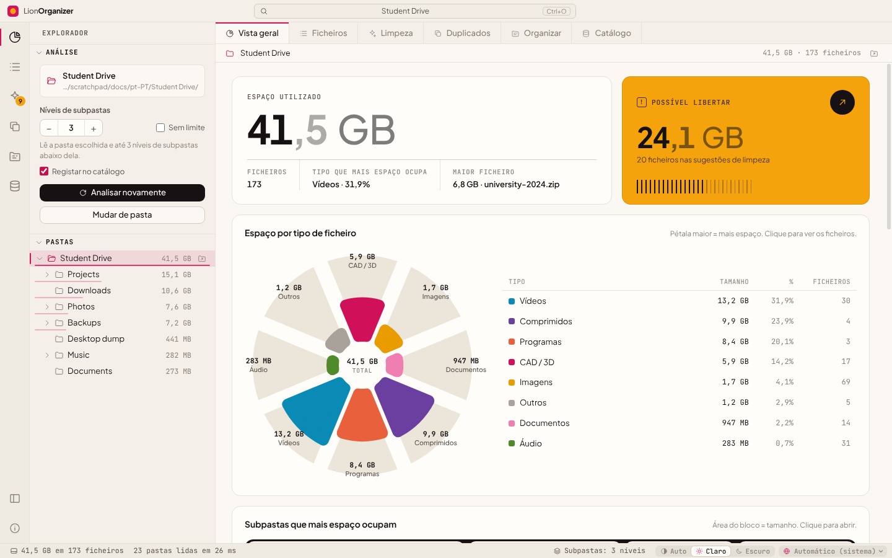

<div align="center">


# LionOrganizer

**Análise e limpeza de espaço em disco para Windows, macOS e Linux.**<br>
Veja o que ocupa espaço nas suas pastas, encontre duplicados verdadeiros pelo conteúdo e liberte em segurança aquilo de que já não precisa.

<sub>pela <b>LionOrganizer Team</b> · criado e idealizado por <b>Daniel Michelon De Carli</b></sub>

[English](../README.md) · [Português (Brasil)](README.pt-BR.md) · **Português (Portugal)** · [Español](README.es.md) · [Français](README.fr.md) · [Deutsch](README.de.md) · [Italiano](README.it.md) · [简体中文](README.zh-CN.md) · [日本語](README.ja.md) · [한국어](README.ko.md)


<p>
  <a href="https://github.com/danielcarli/lionorganizer/releases/latest/download/LionOrganizer-Setup.exe"></a>
  <a href="https://github.com/danielcarli/lionorganizer/releases/latest/download/LionOrganizer-mac-universal.dmg"></a>
  <a href="https://github.com/danielcarli/lionorganizer/releases/latest/download/lionorganizer_amd64.deb"></a>
  <a href="https://github.com/danielcarli/lionorganizer/releases/latest/download/lionorganizer.x86_64.rpm"></a>
  <a href="https://github.com/danielcarli/lionorganizer/releases/latest/download/LionOrganizer-x86_64.AppImage"></a>
</p>

<sub><a href="https://github.com/danielcarli/lionorganizer/releases">Todas as versões</a> · <a href="#transferir">Como instalar</a></sub>



</div>

## Porquê o LionOrganizer?

Os analisadores de disco mostram *o que* é grande. O LionOrganizer também ajuda a decidir *o que pode sair* — e garante que nada é eliminado por engano. Nasceu de um problema muito concreto: os projetos de arquitetura e design acumulam cópias de segurança de CAD (`.skb`, `.0001.rvt`, `.bak`), renders, vídeos e cópias de cópias até o disco ficar cheio.

Tudo é executado **localmente**. Não há conta nem telemetria; a única ligação é a verificação opcional de novas versões.

**O que torna o LionOrganizer diferente**

- **Ajuda a decidir, não só a medir** — sugestões de limpeza agrupadas por motivo, incluindo as cópias de segurança de CAD/BIM que se acumulam em projetos de arquitetura (SketchUp `.skb`, Revit `.0001.rvt`, AutoCAD `.bak`).
- **Nada é eliminado por engano** — cada eliminação pede um código escrito, verificado pela própria aplicação, e os ficheiros vão para a Reciclagem.
- **Duplicados verdadeiros, pelo conteúdo** — confirmados por SHA-256, e é o utilizador que escolhe que cópia manter.
- **Memória entre análises** — um catálogo local para pesquisar em todas as pastas já analisadas (até em discos desligados) e ver o que é novo, foi removido ou cresceu.
- **Organizar e renomear, com anular** — ficheiros soltos arrumados em pastas por tipo e renomeação em lote com padrões, sempre com pré-visualização.
- **Uma segunda opinião da IA** — exporte um relatório no seu idioma para uma IA indicar o que provavelmente é mais seguro eliminar; a aplicação não envia nada. Depois cole a resposta de volta: os ficheiros referidos aparecem com o risco que a IA atribuiu, prontos a rever.
- **Percebe quando os ficheiros desaparecem** — ficheiros eliminados ou movidos fora da aplicação aparecem a cinzento, e pode removê-los das listas.
- **Para todos** — 10 idiomas, temas claro e escuro e instaladores verificados para Windows, macOS e Linux.

## Transferir

Transfira o instalador do seu sistema. Todos obtêm a **versão mais recente** do GitHub e verificam cada ficheiro (SHA-256 e proveniência assinada do build).

- **Windows 10/11** (x64, ARM): assistente de instalação de cerca de 2 MB, que transfere e verifica o programa durante a instalação. → [`LionOrganizer-Setup.exe`](https://github.com/danielcarli/lionorganizer/releases/latest/download/LionOrganizer-Setup.exe)
- **macOS 11+** (Apple Silicon, Intel): abra o `.dmg` e arraste o LionOrganizer para Aplicações. → [`LionOrganizer-mac-universal.dmg`](https://github.com/danielcarli/lionorganizer/releases/latest/download/LionOrganizer-mac-universal.dmg)
- **Linux** (x64): `.deb` para Ubuntu, Debian, Mint…, `.rpm` para Fedora, RHEL, openSUSE…, ou o AppImage, que funciona em qualquer distribuição sem instalação. → [`.deb`](https://github.com/danielcarli/lionorganizer/releases/latest/download/lionorganizer_amd64.deb) · [`.rpm`](https://github.com/danielcarli/lionorganizer/releases/latest/download/lionorganizer.x86_64.rpm) · [AppImage](https://github.com/danielcarli/lionorganizer/releases/latest/download/LionOrganizer-x86_64.AppImage)

> Os instaladores ainda não estão assinados com um certificado pago. Na primeira execução, o Windows pode mostrar "O Windows protegeu o computador" (**Mais informações › Executar mesmo assim**) e o macOS pede para autorizar a aplicação em **Definições do Sistema › Privacidade e segurança › Abrir mesmo assim**.

**Prefere o terminal?** Windows (PowerShell, não precisa de ser administrador):

```powershell
irm https://github.com/danielcarli/lionorganizer/releases/latest/download/install.ps1 | iex
```

macOS e Linux:

```bash
curl -fsSL https://github.com/danielcarli/lionorganizer/releases/latest/download/install.sh | bash
```

[Todas as versões](https://github.com/danielcarli/lionorganizer/releases) · [Guia de instalação](INSTALL.md) (em inglês): detalhes, segurança, atualização e desinstalação.

## Funcionalidades

| | |
|---|---|
| **Analisar** | Percorre uma pasta e as respetivas subpastas — 3 níveis de profundidade por predefinição, configurável até 50 níveis ou sem limite. Árvore de pastas com tamanhos, trilho de navegação e uma tabela de todos os ficheiros, que pode ser ordenada e filtrada. |
| **Pastas grandes** | A última análise reabre de imediato a partir do catálogo, marcada com a data; a pasta só é analisada novamente quando o pede, em segundo plano. Mostra o espaço analisado ao lado do espaço usado no disco, e porquê a diferença (itens inacessíveis, limite de níveis, ficheiros do sistema). Lista opcional de pastas a ignorar (`node_modules`, `.git`, pastas do sistema) — desligada por predefinição. Os itens que o sistema não deixou ler aparecem com o motivo; no Windows é possível analisar novamente como administrador. Feito para milhões de ficheiros: o trabalho pesado corre num processo em segundo plano e as listas grandes são ordenadas fora da interface, por isso a janela não bloqueia. |
| **Visualizar** | Espaço por tipo de ficheiro (gráfico de rosa), maiores subpastas (treemap), uma matriz de 100 pontos em que cada ponto corresponde a 1 % do espaço, as extensões que mais ocupam e a idade dos ficheiros. |
| **Mapa de espaço** | Treemap em ecrã inteiro: cada ficheiro é um bloco, dentro das suas pastas e colorido por tipo. Clique num bloco para entrar na pasta; Backspace ou o botão direito sobe. Pesado em análises grandes, por isso só é construído quando o ativa — em segundo plano, com barra de progresso. |
| **Limpar** | Sugestões agrupadas por motivo: cópias de segurança do SketchUp/Revit/AutoCAD, ficheiros temporários, registos, transferências incompletas, instaladores, ficheiros grandes e antigos. |
| **Mais para limpar** | Caches de render e CAD (Twinmotion, Lumion, Enscape, V-Ray, Corona, journals do Revit, Media Cache da Adobe), ficheiros vazios e pastas vazias — as pastas também só vão para a Reciclagem depois do código digitado. |
| **Duplicados verdadeiros** | Comparação de conteúdo com SHA-256, lendo apenas o necessário (tamanho → primeiros/últimos 64 KB → ficheiro inteiro). Escolha a cópia a manter; veja quando o mesmo ficheiro também existe noutra pasta catalogada (por exemplo, um disco de cópias de segurança). |
| **Organizar** | Mova ficheiros soltos para subpastas por tipo e mude o nome em lote com padrões como `{date}-{n}-{name}`. Sempre com pré-visualização, e tudo pode ser anulado. |
| **Catálogo e histórico** | Um catálogo SQLite local com nomes, tamanhos, datas e hashes. Pesquise em todas as pastas já analisadas — mesmo em unidades desligadas — e compare análises para ver o que é novo, o que foi removido ou o que está a crescer. |
| **10 idiomas** | English, Português (Brasil), Português (Portugal), Español, Français, Deutsch, Italiano, 简体中文, 日本語, 한국어 — detetado a partir do sistema e alternável na barra de estado. |
| **Claro e escuro** | Tema automático ou manual, com uma paleta de cores verificada para deficiências na visão das cores. |

## Segurança em primeiro lugar

Eliminar o ficheiro errado é pior do que ter o disco cheio, por isso o LionOrganizer é deliberadamente cuidadoso:

- **Código de confirmação escrito.** Todas as ações que alteram ficheiros — *qualquer* eliminação (de um ficheiro ou de vários), organizar, mudar o nome, anular e limpar o catálogo — mostram um código de 6 carateres que tem de ser **escrito** (colar está desativado) para que o botão fique disponível. O código é gerado e verificado pelo processo principal, pelo que a interface não o pode contornar. Cinco tentativas erradas cancelam a operação.
- **Reciclagem, não eliminação permanente.** Os ficheiros eliminados vão para a Reciclagem do Windows.
- **Ações delimitadas.** O processo principal só mexe em ficheiros que pertencem à pasta analisada e que foram vistos na última análise.
- **Anular.** As operações de organizar e de mudar o nome ficam registadas e podem ser revertidas em *Catálogo → Operações recentes*.
- **Só de leitura por predefinição.** Analisar e procurar duplicados nunca alteram nada.

<div align="center">

</div>

## Capturas de ecrã

| | |
|---|---|
|  **Duplicados** — cópias idênticas agrupadas por SHA-256 |  **Limpeza** — sugestões agrupadas por motivo |
|  **Organizar** — por tipo e mudança de nome em lote, com pré-visualização |  **Catálogo** — pesquisa, histórico e anular |
|  **Ficheiros** — todos os ficheiros, com ordenação e filtros |  **Tema escuro** |

As restantes capturas de ecrã mostram a interface em inglês.

<div align="center">

<br><sub>O mesmo ecrã nos dez idiomas suportados.</sub>
</div>

## Introdução

### Executar a partir do código-fonte (Windows)

1. Instale o [Node.js LTS](https://nodejs.org).
2. Transfira ou clone este repositório.
3. Faça duplo clique em **`start.bat`** — na primeira execução, as dependências são instaladas.

Ou a partir de um terminal:

```powershell
npm install
npm start
```

> No PowerShell, se os scripts estiverem desativados, utilize `npm.cmd` em vez de `npm`.

### Criar um instalador

Faça duplo clique em **`build-installer.bat`** (ou execute `npm run dist`). São criados um instalador e um `.exe` portátil em `dist/`.

## Atalhos de teclado

| Atalho | Ação |
|---|---|
| `Ctrl+O` | Abrir pasta |
| `F5` | Analisar novamente |
| `Ctrl+1` … `Ctrl+7` | Vista geral · Ficheiros · Limpeza · Duplicados · Organizar · Catálogo · Mapa de espaço |
| `Ctrl+B` | Mostrar/ocultar barra lateral |
| `Esc` | Cancelar a análise ou a verificação de duplicados em curso |

## Idiomas

| Idioma | Código | | Idioma | Código |
|---|---|---|---|---|
| English | `en` | | Deutsch | `de` |
| Português (Brasil) | `pt-BR` | | Italiano | `it` |
| Português (Portugal) | `pt-PT` | | 简体中文 | `zh-CN` |
| Español | `es` | | 日本語 | `ja` |
| Français | `fr` | | 한국어 | `ko` |

Por predefinição, o idioma acompanha o do Windows e pode ser alterado na barra de estado. Os números, as datas e as unidades de tamanho seguem o idioma selecionado (por exemplo, em francês aparecem *Mo* e *Go*). As traduções em falta são apresentadas em inglês.

Quer adicionar ou melhorar um idioma? Consulte o [CONTRIBUTING.md](../CONTRIBUTING.md#translations) — basta um ficheiro JSON.

## Privacidade

O LionOrganizer funciona offline. A única ligação é a verificação de novas versões: lê um ficheiro pequeno das versões publicadas do projeto no GitHub e não envia nenhum dado seu ou dos seus ficheiros. Pode desligá-la clicando no número da versão, no canto inferior direito. O relatório de *Exportar para IA* nunca é enviado pela aplicação: é o utilizador que escolhe onde o colar.

O catálogo é um único ficheiro no seu computador:

```
%APPDATA%\LionOrganizer\catalog.sqlite
```

Pode desativar o registo (“Registar no catálogo”, na barra lateral), exportá-lo para CSV ou limpá-lo na vista *Catálogo* a qualquer momento. Limpar o catálogo nunca elimina os seus ficheiros.

## Arquitetura

O código segue a organização em camadas do [Visual Studio Code](https://github.com/microsoft/vscode): `base` não conhece nada acima de si, `platform` fornece os serviços do sistema e `workbench` constrói a interface. O processo principal (Node.js) e a interface (um renderer em sandbox, sem acesso ao Node) só comunicam através da ponte `preload`.

```
src/
  base/
    common/              pure utilities: events, formatting, i18n (nls.js)
    browser/             DOM helpers, icons, charts (rose, treemap, dot matrix, bars, hatched columns)
  platform/              main-process services
    files/               folder scanner with depth limit
    catalog/             SQLite catalog, history, operation log, duplicate finder (SHA-256)
    operations/          file-changing operations guarded by the typed confirmation code
    shell/ · dialogs/    Explorer integration, native dialogs
    nls/                 i18n for the main process
  code/
    electron-main/       entry point: window, app:// protocol, service wiring
    electron-sandbox/    preload bridge
  nls/                   message catalogs: en.json, pt-BR.json, … (one file per language)
  workbench/
    browser/             bootstrap, layout parts (title bar, activity bar, side bar, editor, status bar), styles
    services/            analysis model, scan, layout, notifications, operations, confirmation, duplicates, catalog
    contrib/             views: overview, files, cleanup, duplicates, organize, catalog
```

Segurança: `contextIsolation` e `sandbox` ativados, sem `nodeIntegration`, uma Content Security Policy rigorosa, e todos os pedidos que alteram ficheiros são validados no processo principal.

## Desenvolvimento

| Comando | O que faz |
|---|---|
| `npm start` | Executa a aplicação |
| `npm run dist` | Cria o instalador para Windows e a aplicação portátil |
| `npm run test:e2e` | Teste de ponta a ponta: analisa uma pasta **descartável** e põe à prova os duplicados, a eliminação, organizar, mudar o nome, anular e o catálogo, verificando os resultados no disco |
| `npm run docs:screenshots` | Volta a gerar as capturas de ecrã em `docs/screenshots` |

```powershell
# the end-to-end test changes files: always point it to a throwaway folder
$env:E2E_FOLDER="C:\temp\lion-test"; $env:E2E_OUT="C:\temp\lion-out"; npm run test:e2e
```

## Contribuir

Relatórios de erros, ideias e pull requests são bem-vindos — sobretudo traduções. Leia o [CONTRIBUTING.md](../CONTRIBUTING.md).

## Créditos

O LionOrganizer foi **criado e idealizado por Daniel Michelon De Carli**, estudante de Arquitetura e Urbanismo, e é mantido pela **LionOrganizer Team** juntamente com os seus colaboradores e tradutores.

Tipos de letra incluídos: [Plus Jakarta Sans](https://github.com/tokotype/PlusJakartaSans) e [JetBrains Mono](https://github.com/JetBrains/JetBrainsMono), ao abrigo da SIL Open Font License. A arquitetura inspira-se no [Visual Studio Code](https://github.com/microsoft/vscode).

## Licença

Copyright © 2026 LionOrganizer Team.

O LionOrganizer é software livre: pode redistribuí-lo e/ou modificá-lo nos termos da **[GNU General Public License v3.0](../LICENSE)**, tal como publicada pela Free Software Foundation, na versão 3 da Licença ou (à sua escolha) em qualquer versão posterior. É distribuído na esperança de que seja útil, mas **sem qualquer garantia**; consulte a licença para mais pormenores.

Em resumo: pode utilizar, estudar, partilhar e alterar o LionOrganizer livremente; se distribuir uma versão modificada, esta também tem de ser publicada ao abrigo da GPL, juntamente com o código-fonte.

Esta tradução é apenas informativa: o texto da licença em inglês, no ficheiro [LICENSE](../LICENSE), é o único juridicamente vinculativo.
